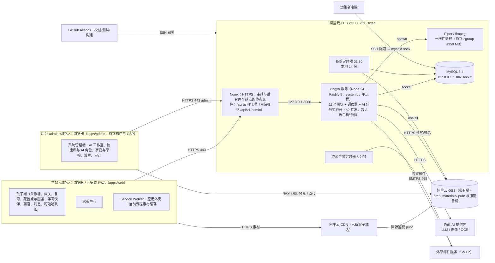

# 方案总览

> 本文由已确认的《星芽学园全新系统设计规格》（2026-10-21，提交 6b463ed）拆分而来；章节编号沿用原规格，便于交叉引用（编号与文件的对应见 [docs/README.md](../README.md)）。
> 2026-10-21 设计变更（用户已批准，见 [v1.0 变更记录](../06-releases/v1.0/changes.md)）：课程入库并版本化、素材在 OSS + CDN、发布时一次性运行 Piper、新增 companion / discovery / studio 三个模块（共 11 个业务模块）。第 10 部分（用户已批准）：studio 增加 Skill 版本库、AI 角色、角色执行器与多角色流水线（+10 张表，共 65 张）。


## 3.1 部署拓扑



## 3.2 技术栈
| 层 | 选型 | 说明 |
| --- | --- | --- |
| 前端 | React 19、Vite、React Router、TanStack Query、vite-plugin-pwa（Workbox）、CSS Modules | 两个前端应用：`apps/web`（孩子端与家长中心两个懒加载路由块，可安装 PWA）与 `apps/admin`（系统管理端，独立构建、独立子域名与 CSP，不做 PWA；ADR 0015），共享 `packages/ui` 主题；伙伴与呀哈哈动画用“关键帧图片 + 动效模板”客户端渲染（CSS/Web Animations） |
| 服务端 | Node 24 LTS、TypeScript（strict）、Fastify 5、Zod（请求/响应/课程文档/AI 输出共用）、Kysely、mysql2、pino、nodemailer、阿里云 OSS SDK | 单进程；时间统一通过可注入的 `Clock` 获取（测试可控） |
| 数据库 | MySQL 8.4 LTS、InnoDB、utf8mb4、REPEATABLE READ | 连接 `time_zone='+00:00'`；所有 DATETIME 存 UTC；任务队列也在 MySQL |
| 文档抽取 | 在 worker 线程中抽取 PDF 文字层、docx、pptx 文本（`resourceLimits` 限制堆 128 MB、超时 60 秒；docx/pptx 解压总量 ≤ 100 MB、条目数 ≤ 2000，防压缩炸弹；不执行宏、不解析外部链接）；照片走云端 OCR 适配器 | 扫描版 PDF 首发不支持 |
| 语音 | Piper（一次性进程，安装在服务器 `/opt/xingya/piper`）、ffmpeg（编码 MP3、变调） | 只在发布/设计任务中运行，无常驻语音服务 |
| AI 提供方 | 适配器接口：LLM、图像、OCR（推荐见开放问题 Q15） | 生成结果必须通过 Zod 模式校验 |
| 存储与分发 | 阿里云 OSS + CDN | 素材按内容哈希命名，永久缓存 |
| 测试 | Vitest（`apps/api/test/{unit,integration,concurrency,safety}`）、Playwright（`apps/web/e2e`、`apps/admin/e2e`）、`tools/safety-eval`（儿童安全评测） | 集成测试用 CI 中真实 MySQL 8.4；AI、OSS、Piper 用桩 |
| 运维 | Nginx、systemd、GitHub Actions、ossutil、age（备份加密） | 无容器编排 |

## 仓库目录结构（已批准；2026-10-21 按设计变更、第 10 部分与目录调整〔ADR 0015〕更新）

```
xingya/
├── .github/
│   └── workflows/
├── apps/
│   ├── admin/
│   │   ├── e2e/
│   │   └── src/
│   │       ├── app/
│   │       ├── components/
│   │       ├── features/
│   │       │   ├── agents/
│   │       │   ├── audit/
│   │       │   ├── courses/
│   │       │   ├── families/
│   │       │   ├── pets/
│   │       │   ├── rules/
│   │       │   ├── runs/
│   │       │   ├── settings/
│   │       │   ├── skills/
│   │       │   ├── studio/
│   │       │   └── yahaha/
│   │       └── lib/
│   ├── api/
│   │   ├── src/
│   │   │   ├── modules/
│   │   │   │   ├── chat/
│   │   │   │   ├── companion/
│   │   │   │   ├── content/
│   │   │   │   ├── controls/
│   │   │   │   ├── discovery/
│   │   │   │   ├── family/
│   │   │   │   ├── learning/
│   │   │   │   ├── reports/
│   │   │   │   ├── social/
│   │   │   │   ├── stars/
│   │   │   │   └── studio/
│   │   │   │       ├── agents/
│   │   │   │       ├── assets/
│   │   │   │       ├── jobs/
│   │   │   │       ├── providers/
│   │   │   │       ├── runner/
│   │   │   │       ├── skills/
│   │   │   │       └── tools/
│   │   │   └── platform/
│   │   │       ├── auth/
│   │   │       ├── config/
│   │   │       ├── db/
│   │   │       └── logging/
│   │   └── test/
│   │       ├── concurrency/
│   │       ├── integration/
│   │       ├── safety/
│   │       └── unit/
│   └── web/
│       ├── e2e/
│       ├── public/
│       └── src/
│           ├── app/
│           ├── components/
│           ├── features/
│           │   ├── child/
│           │   │   ├── album/
│           │   │   ├── chat/
│           │   │   ├── companion/
│           │   │   ├── discovery/
│           │   │   ├── learn/
│           │   │   ├── login/
│           │   │   ├── review/
│           │   │   ├── shop/
│           │   │   └── social/
│           │   └── parent/
│           │       ├── approvals/
│           │       ├── controls/
│           │       ├── dashboard/
│           │       └── reports/
│           └── lib/
├── db/
│   ├── migrations/
│   │   └── 0001_init.sql
│   ├── seeds/
│   ├── verify/
│   │   ├── result.txt
│   │   └── verify.mjs
│   └── roles.sql
├── deploy/
│   ├── nginx/
│   ├── scripts/
│   └── systemd/
├── docs/
│   ├── 01-requirements/
│   │   ├── modules/
│   │   │   ├── agents.md
│   │   │   ├── chat.md
│   │   │   ├── companion.md
│   │   │   ├── content.md
│   │   │   ├── controls.md
│   │   │   ├── discovery.md
│   │   │   ├── family.md
│   │   │   ├── learning.md
│   │   │   ├── reports.md
│   │   │   ├── social.md
│   │   │   ├── stars.md
│   │   │   └── studio.md
│   │   ├── PRD.md
│   │   ├── nfr.md
│   │   └── open-questions.md
│   ├── 02-solution/
│   │   ├── deployment.md
│   │   ├── overview.md
│   │   └── roadmap.md
│   ├── 03-design/
│   │   ├── modules/
│   │   │   ├── agents.md
│   │   │   ├── chat.md
│   │   │   ├── companion.md
│   │   │   ├── content.md
│   │   │   ├── controls.md
│   │   │   ├── discovery.md
│   │   │   ├── family.md
│   │   │   ├── learning.md
│   │   │   ├── reports.md
│   │   │   ├── social.md
│   │   │   ├── stars.md
│   │   │   └── studio.md
│   │   ├── api.md
│   │   ├── course-model.md
│   │   └── data-model.md
│   ├── 04-ui-design/
│   │   ├── characters/
│   │   ├── components/
│   │   ├── flows/
│   │   │   ├── admin/
│   │   │   ├── child/
│   │   │   └── parent/
│   │   ├── mockups/
│   │   │   ├── admin/
│   │   │   │   ├── agents/
│   │   │   │   ├── audit/
│   │   │   │   ├── courses/
│   │   │   │   ├── families/
│   │   │   │   ├── pets/
│   │   │   │   ├── rules/
│   │   │   │   ├── runs/
│   │   │   │   ├── settings/
│   │   │   │   ├── skills/
│   │   │   │   ├── studio/
│   │   │   │   └── yahaha/
│   │   │   ├── child/
│   │   │   │   ├── album/
│   │   │   │   ├── chat/
│   │   │   │   ├── companion/
│   │   │   │   ├── discovery/
│   │   │   │   ├── learn/
│   │   │   │   ├── login/
│   │   │   │   ├── review/
│   │   │   │   ├── shop/
│   │   │   │   └── social/
│   │   │   └── parent/
│   │   │       ├── approvals/
│   │   │       ├── controls/
│   │   │       ├── dashboard/
│   │   │       └── reports/
│   │   ├── tokens/
│   │   └── wireframes/
│   │       ├── admin/
│   │       │   ├── agents/
│   │       │   ├── audit/
│   │       │   ├── courses/
│   │       │   ├── families/
│   │       │   ├── pets/
│   │       │   ├── rules/
│   │       │   ├── runs/
│   │       │   ├── settings/
│   │       │   ├── skills/
│   │       │   ├── studio/
│   │       │   └── yahaha/
│   │       ├── child/
│   │       │   ├── album/
│   │       │   ├── chat/
│   │       │   ├── companion/
│   │       │   ├── discovery/
│   │       │   ├── learn/
│   │       │   ├── login/
│   │       │   ├── review/
│   │       │   ├── shop/
│   │       │   └── social/
│   │       └── parent/
│   │           ├── approvals/
│   │           ├── controls/
│   │           ├── dashboard/
│   │           └── reports/
│   ├── 05-plans/
│   ├── 06-releases/
│   │   ├── v1.0/
│   │   │   ├── acceptance.md
│   │   │   ├── changes.md
│   │   │   ├── release-notes.md
│   │   │   └── scope.md
│   │   └── backlog.md
│   ├── adr/
│   │   ├── 0001-modular-monolith.md
│   │   ├── 0002-mysql-local-only-ssh-tunnel.md
│   │   ├── 0003-content-as-code-build-time-tts.md
│   │   ├── 0004-append-only-star-ledger.md
│   │   ├── 0005-web-only-pwa-launch.md
│   │   ├── 0006-cross-family-social-safeguards.md
│   │   ├── 0007-family-as-tenant.md
│   │   ├── 0008-db-versioned-courses-word-bank.md
│   │   ├── 0009-studio-mysql-job-queue.md
│   │   ├── 0010-oss-cdn-publish-time-piper.md
│   │   ├── 0011-fragments-second-currency.md
│   │   ├── 0012-server-decided-discovery-ai-filled-rules.md
│   │   ├── 0013-keyframe-motion-template-animation.md
│   │   ├── 0014-skills-and-agent-roles.md
│   │   └── 0015-admin-app-and-seeds.md
│   └── reviews/
│       └── 2026-10-21-整体评审.md
├── packages/
│   ├── contracts/
│   ├── rules/
│   ├── seed-schema/
│   ├── skill-format/
│   └── ui/
├── seeds/
│   ├── agents/
│   ├── avatars/
│   ├── course-templates/
│   ├── phrases/
│   ├── safety/
│   ├── samples/
│   │   └── english/
│   │       └── grade-1/
│   ├── shop/
│   └── skills/
├── tools/
│   ├── safety-eval/
│   └── validate-seeds/
├── .gitignore
├── CHANGELOG.md
├── package.json
├── pnpm-workspace.yaml
└── tsconfig.base.json
```

（树中省略了各目录的 `README.md` 与空目录的 `.gitkeep`。）

每个后端模块目录 `apps/api/src/modules/<module>/` 的文件约定（原 §3.3）：

| 文件 | 内容 |
| --- | --- |
| `index.ts` | 模块公开接口（唯一允许被其他模块 import 的文件） |
| `routes.ts` | HTTP 路由（Zod 模式） |
| `service.ts` | 业务规则 |
| `repo.ts` | 本模块表的 Kysely 查询（只碰自己的表） |
| 单元测试 | 不放在模块目录；在 `apps/api/test/unit/<module>/`（并发与儿童安全用例在 `test/concurrency/`、`test/safety/`） |

`apps/api/src/platform/`：`db/`（连接、事务、幂等、迁移与 `seeds:apply`）、`auth/`（会话、主体、TOTP、主站/后台域名区分）、`logging/`（日志、错误格式）、`config/`（配置、Clock、调度器、OSS 客户端、邮件发送）。studio 模块内部分为 `jobs/`、`assets/`、`skills/`、`agents/`、`runner/`、`tools/`、`providers/` 子目录（仍是一个模块、一个 `index.ts`）。

原规格 §3.3 的路径与批准结构的对应：

| 原规格 §3.3 | 批准的结构 |
| --- | --- |
| `apps/server/src/modules/<module>/`（identity … yahaha …） | `apps/api/src/modules/<module>/`；模块代码名 identity → `family`，yahaha（聊天）→ `chat`（接口路径 `/api/v1/yahaha/*` 不变）；2026-10-21 新增 `companion`、`discovery`、`studio` |
| `apps/server/src/platform/` | `apps/api/src/platform/` |
| `apps/web/`（child/、parent/、admin/ 三个路由块） | `apps/web/src/features/{child,parent}`（孩子端与家长中心，两个懒加载路由块）；管理端拆为独立应用 `apps/admin/src/features/{studio,skills,agents,runs,courses,pets,yahaha,rules,families,settings,audit}`（ADR 0015） |
| `packages/shared/`（API 与课程包 Zod、错误码、规则常量） | `packages/contracts`（API Zod、错误码）、`packages/rules`（规则常量与纯函数）、`packages/seed-schema`（原 content-schema：课程文档、模板与题型 Zod、K 规则、内置数据模式）、`packages/ui`（主题与基础组件）、`packages/skill-format`（SKILL.md 格式与校验） |
| `packages/content-tools/`（validate / build / import / gen-audio / legacy-convert） | `tools/validate-seeds`（原 validate-content，校验 `seeds/`）、`tools/safety-eval`（儿童安全评测）；导入为 `apps/api` 的 `xingya course:import`（示例课程 → 草稿）；构建期音频（gen-audio）与课程包组装（build）**取消**（[ADR 0010](../adr/0010-oss-cdn-publish-time-piper.md)）；旧内容转换（legacy-convert）取消，首发课程在后台制作 |
| `content/` | `seeds/`（ADR 0015 由 `content/` 改名）：`course-templates/`、`skills/`、`agents/`、`safety/`、`phrases/`、`avatars/`、`shop/`、`samples/english/grade-1/`（仅作示例）；见 [seeds/README.md](../../seeds/README.md)、[课程模型](../03-design/course-model.md)、[Skill 与 AI 角色](../03-design/modules/agents.md) |
| `db/migrations/`（V001__init.sql） | `db/migrations/0001_init.sql`、`db/roles.sql`、`db/dev-fixtures/`、`db/verify/` |
| `deploy/` | `deploy/{nginx,systemd,scripts}` |
| `e2e/` | `apps/web/e2e/`、`apps/admin/e2e/`；服务端测试在 `apps/api/test/{unit,integration,concurrency,safety}/` |
| `docs/` | `docs/01-requirements` … `06-releases`、`docs/adr`、`docs/reviews` |

## 哪些内容上服务器

| 仓库目录 | 是否上服务器 | 说明 |
| --- | --- | --- |
| `apps/api` | 是 | 编译为服务产物 → `releases/<ts-version>/api/`；`db/migrations` 与 `db/roles.sql` 随之打包 |
| `apps/web` | 是 | Vite 构建产物（含 PWA 外壳）→ `releases/<ts-version>/web/`（主域名；不含任何后台代码） |
| `apps/admin` | 是 | Vite 构建产物 → `releases/<ts-version>/admin/`（后台子域名 `admin.<域名>`，不经 CDN） |
| `packages/*` | 间接 | 不单独部署，构建时编译进 api、web、admin 的产物 |
| `seeds/` | 是 | → `releases/<ts-version>/seeds/`。`course-templates`、`safety`、`phrases`、`avatars`：api 启动时读取，不入库；`shop`、`skills`、`agents`：每次部署由 `xingya seeds:apply` 只插入缺失行（不覆盖后台修改）；`samples`：只在运维手动 `xingya course:import` 时导入为草稿 |
| `tools/*` | 否 | 只在 CI 与本地运行 |
| `db/dev-fixtures`、`db/verify` | 否 | 开发与 e2e 的 SQL 示例行、结构验证（`db/dev-fixtures` 与顶层 `seeds/` 不同，见 `db/dev-fixtures/README.md`） |
| `deploy/nginx` | 是 | → `/etc/nginx/` |
| `deploy/systemd` | 是 | → `/etc/systemd/system/` |
| `deploy/scripts` | 是 | → `/opt/xingya/scripts/` |
| `docs/`、`.github/`、测试目录 | 否 | |

**没有课程包。** 课程、词库、伙伴、呀哈哈款式与规则都在数据库；图片、音频、动画素材都在阿里云 OSS（`pub/` 经 CDN 提供）；服务器上只额外安装 Piper 二进制与声音模型。

服务器目录布局：

```
/opt/xingya/
  releases/
    <ts-version>/            # 例：20261021-2056-6b463ed（时间戳 + 提交短哈希）
      api/                   # 服务编译产物 + db/migrations + db/roles.sql
      web/                   # 孩子端与家长中心构建产物（主域名）
      admin/                 # 系统管理端构建产物（admin.<域名>）
      seeds/                 # 内置数据（模板、安全词表与守则、短语、头像、默认技能与角色、装扮、示例）
  current -> releases/<ts-version>   # 当前版本；回滚 = 把软链接切回上一个发布并重启
  scripts/                   # 来自 deploy/scripts：bootstrap、deploy、rollback、backup、alerts
  piper/
    bin/                     # Piper 可执行文件（bootstrap 安装，校验 SHA-256）
    voices/                  # 声音模型 *.onnx + *.onnx.json（首发 zh_CN、en_US 各 1 个）
/var/lib/xingya/tmp/         # 一次性进程的临时文件（任务结束即删）
/etc/xingya/secrets.env      # 0600：数据库口令、会话 HMAC 密钥、TOTP 加密密钥、LLM/图像/OCR Key、OSS RAM 子账号 AccessKey、SMTP 凭据
/etc/nginx/                  # 来自 deploy/nginx
/etc/systemd/system/         # 来自 deploy/systemd
/var/backups/xingya/         # 每日数据库备份（14 份）与 backup-status.json
```
保留最近 3 个发布目录。

## 3.4 模块与边界规则
11 个业务模块 + 平台层，各自拥有自己的表（共 65 张 = 62 业务 + 3 平台），只通过 `index.ts` 暴露函数：

| 模块 | 代码名 | 拥有的表 | 表数 |
| --- | --- | --- | --- |
| 家庭账号 | family | families, parents, children, admin_accounts, family_devices, sessions, auth_tokens, audit_events | 8 |
| AI 工作室（含 Skill 与 AI 角色） | studio | ai_jobs, ai_budget_months, assets, materials；skills, skill_versions, skill_allowed_agents, agents, agent_versions, agent_skills, agent_budget_months, agent_runs, agent_run_steps, quick_tasks | 14 |
| 课程内容 | content | words, word_senses, courses, course_versions, course_drafts, levels, questions, question_answers；内存中的模板、头像、短语/表情、安全词表 | 8 |
| 学习 | learning | plays, level_progress, attempts, review_items, review_sessions | 5 |
| 星星 | stars | ledger, balances, shop_items, child_items, reward_options, redemptions | 6 |
| 学习伙伴 | companion | pet_tiers, pet_tier_stages, pet_species, pet_dens, child_pets | 5 |
| 呀哈哈发现 | discovery | yahaha_sets, yahaha_styles, drop_rules, hiding_spots, yahaha_finds | 5 |
| 社交 | social | family_friendships, gifts, messages, blocks, abuse_reports | 5 |
| AI 聊天（呀哈哈队长） | chat | ai_chat_usage | 1 |
| 家长管控 | controls | child_controls, course_overrides, usage_days | 3 |
| 报告通知 | reports | daily_reports, email_outbox | 2 |
| 平台（非业务模块） | platform | system_settings, idempotency_requests, schema_migrations | 3 |

边界规则（CI 强制）：
1. 模块之间只能 import 对方的 `index.ts`（dependency-cruiser 规则）。
2. `repo.ts` 只能引用本模块的表（一个测试扫描 Kysely 表名与上表比对）。
3. 跨模块写入在**同一事务**内完成：发起业务操作的模块开启事务，把 `tx` 传给其他模块以 `…InTx` 结尾的函数；被调用方从不自行提交。
4. 模块依赖无环（A → B 表示 A 调用 B）：
   - learning → controls、stars、content、companion、discovery（完成结算时发星/碎片、加经验、放置藏匿点）、studio（注册呀哈哈队长的只读工具 `child.learned_words`）
   - discovery → stars（碎片与奖励星）、content（课程/关卡范围校验）、studio（注册款式与规则草稿工具、发起角色任务）
   - companion → stars（领养与扩建扣费、学习星累计）、studio（注册伙伴草稿工具、发起角色任务）
   - content → studio（注册课程草稿工具、发起角色任务、发布音频系统任务、素材）
   - controls → content（课程列表），并只读调用 stars 与 social（审批收件箱）
   - stars → studio（装扮图片素材只读）
   - social → stars；chat → controls、studio（同步运行儿童角色呀哈哈队长、预算）；reports → 各模块的只读查询函数、studio（注册只读聚合工具 `stats.aggregate`）
   - 所有模块 → family（读取家庭、孩子）
   - studio、family 不依赖任何业务模块（studio 只依赖 platform）；stars 不再依赖 content（装扮表归 stars），只读依赖 studio 的素材。
5. **工具注册（依赖倒置）**：content、companion、discovery、learning、reports 在启动时向 studio 注册 AI 角色可用的**内置工具**（`registerTool`：只读、写草稿或生成；没有发布类工具）；AI 流程全部由“AI 角色 + 技能”执行（ADR 0014）。确定性的系统任务仍用 `registerHandler`：`publish_audio`（content）、`material_extract`（studio）。studio 只负责技能与角色、执行器、排队、并发、预算、调用提供方与保存素材，工具把结果写回各自模块的表。

### content 与 studio 的分工
| 问题 | 归属 |
| --- | --- |
| “生成 4 张候选图要多少钱、能不能现在跑、跑完存哪里” | studio |
| “由哪个角色、用哪个技能版本、可以调用哪些工具、每一步花了多少” | studio |
| “这道题答案对不对、这门课能不能发布、发布成哪个版本” | content |
| “这只伙伴属于哪个档位、能不能领养” | companion |
| “这条规则什么时候生效、概率多少” | discovery |

## 3.6 后台任务（进程内调度器，单实例）
| 任务 | 周期 | 内容 |
| --- | --- | --- |
| AI 任务执行器 | 每 2 秒轮询 | 取 `queued` 任务按 `queued_at` 顺序抢占空闲槽位（槽位 1/2 唯一键；本机进程类最多 1 个）；运行中每 15 秒心跳；超过 2 分钟无心跳的任务释放槽位并重试（最多 3 次），预留费用在失败时释放。`agent_run` 任务由角色执行器运行（工具循环 ≤ 20 步、超时见 `agents.limits`）；流水线某步完成后在同一事务中入队下一步 |
| 作答清理 | 每小时 | 把过期未完成的 `plays` 标记 `expired`；过期 7 天后删除（已完成的作答保留，被闯关/复习记录引用） |
| 投放规则状态 | 每分钟 | 已发布规则到 `starts_at` 生效、到 `ends_at` 标记 `ended`；总量用完的规则不再参与放置；状态变化写审计 |
| 预算月切换 | 每天 00:05（UTC+8） | 若当月 `ai_budget_months` 行不存在，按 `studio.default_monthly_cap_fen` 创建；角色的 `agent_budget_months` 在当月首次使用时按角色当前版本的月度预算创建；跨月未结束的任务仍记在入队月份 |
| 夜间汇总 | 每 15 分钟检查 | 对本地时间已过 00:30 且“昨天”尚未汇总的家庭生成 `daily_reports`（幂等 UPSERT） |
| 周报入队 | 每 5 分钟检查 | 对本地时间为周日 20:00–23:59 的家庭，为每个已验证邮箱且订阅的家长入队，去重键 `weekly:{parentId}:{ISO周}` |
| 邮件发送 | 每 30 秒 | 发送到期邮件；退避 1m/5m/30m/2h/6h…，最多 10 次后 `failed` 并告警 |
| 账本对账 | 每天 04:00（UTC+8） | 每个孩子每个币种 `SUM(delta)` = `balances.balance` = 最后一行 `balance_after`；`yahaha_styles.placed_total` = 该款式藏匿点数；不一致写审计并发管理员告警 |
| 数据清理 | 每天 04:30（UTC+8） | AI 元数据 > 90 天、幂等记录 > 30 天、过期会话/令牌、已发送邮件正文（发送后即清空，此处兜底）、发送完成 > 180 天的邮件行、已结束 > 180 天的 AI 任务参数中的资料文本、90 天未被引用的草稿素材归档、AI 运行步骤（`agent_run_steps`）> 180 天（运行汇总 `agent_runs` 保留） |

调度器在任务执行时用 MySQL `GET_LOCK('xingya:job:<name>', 0)` 防止重叠执行（例如部署切换瞬间两个进程并存）；AI 任务的并发由数据库槽位保证，与 `GET_LOCK` 无关。

> 各模块的接口见 `docs/03-design/modules/`；部署细节见 [deployment.md](deployment.md)。
