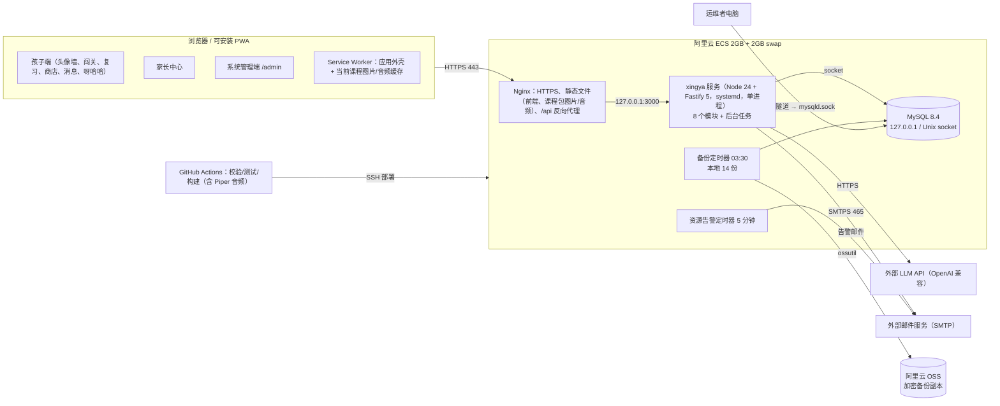

# 方案总览

> 本文由已确认的《星芽学园全新系统设计规格》（2026-10-21，提交 6b463ed）拆分而来；章节编号沿用原规格，便于交叉引用（编号与文件的对应见 [docs/README.md](../README.md)）。


## 3.1 部署拓扑



## 3.2 技术栈
| 层 | 选型 | 说明 |
| --- | --- | --- |
| 前端 | React 19、Vite、React Router、TanStack Query、vite-plugin-pwa（Workbox）、CSS Modules | 孩子端/家长端/管理端三个懒加载路由块 |
| 服务端 | Node 24 LTS、TypeScript（strict）、Fastify 5、Zod（请求/响应/课程包共用）、Kysely、mysql2、pino、nodemailer | 单进程；时间统一通过可注入的 `Clock` 获取（测试可控） |
| 数据库 | MySQL 8.4 LTS、InnoDB、utf8mb4、REPEATABLE READ | 连接 `time_zone='+00:00'`；所有 DATETIME 存 UTC |
| 内容工具 | Zod 校验器、构建器、导入器、Piper（离线）、ffmpeg（编码 MP3） | 只在 CI 与部署时运行 |
| 测试 | Vitest（单元/集成）、Playwright（端到端） | 集成测试用 CI 中真实 MySQL 8.4 |
| 运维 | Nginx、systemd、GitHub Actions、ossutil、age（备份加密） | 无容器编排 |

## 仓库目录结构（已批准；取代原 §3.3）

```
xingya/
├── .github/
│   └── workflows/
├── apps/
│   ├── api/
│   │   ├── src/
│   │   │   ├── modules/
│   │   │   │   ├── chat/
│   │   │   │   ├── content/
│   │   │   │   ├── controls/
│   │   │   │   ├── family/
│   │   │   │   ├── learning/
│   │   │   │   ├── reports/
│   │   │   │   ├── social/
│   │   │   │   └── stars/
│   │   │   └── platform/
│   │   └── test/
│   │       └── integration/
│   └── web/
│       ├── e2e/
│       ├── public/
│       └── src/
│           ├── app/
│           ├── components/
│           ├── features/
│           │   ├── admin/
│           │   ├── chat/
│           │   ├── learn/
│           │   ├── login/
│           │   ├── parent/
│           │   ├── review/
│           │   ├── shop/
│           │   └── social/
│           └── lib/
├── content/
│   ├── english/
│   │   └── grade-1/
│   ├── phrases/
│   └── shop/
├── db/
│   ├── migrations/
│   │   └── 0001_init.sql
│   ├── seeds/
│   ├── verify/
│   │   ├── result.txt
│   │   └── verify.mjs
│   └── roles.sql
├── deploy/
│   ├── nginx/
│   ├── scripts/
│   └── systemd/
├── docs/
│   ├── 01-requirements/
│   │   ├── modules/
│   │   │   ├── chat.md
│   │   │   ├── content.md
│   │   │   ├── controls.md
│   │   │   ├── family.md
│   │   │   ├── learning.md
│   │   │   ├── reports.md
│   │   │   ├── social.md
│   │   │   └── stars.md
│   │   ├── PRD.md
│   │   ├── nfr.md
│   │   └── open-questions.md
│   ├── 02-solution/
│   │   ├── deployment.md
│   │   ├── overview.md
│   │   └── roadmap.md
│   ├── 03-design/
│   │   ├── modules/
│   │   │   ├── chat.md
│   │   │   ├── content.md
│   │   │   ├── controls.md
│   │   │   ├── family.md
│   │   │   ├── learning.md
│   │   │   ├── reports.md
│   │   │   ├── social.md
│   │   │   └── stars.md
│   │   ├── api.md
│   │   ├── content-pack.md
│   │   └── data-model.md
│   ├── 04-ui-design/
│   │   ├── characters/
│   │   ├── components/
│   │   ├── flows/
│   │   ├── mockups/
│   │   │   ├── admin/
│   │   │   ├── chat/
│   │   │   ├── learn/
│   │   │   ├── login/
│   │   │   ├── parent/
│   │   │   ├── review/
│   │   │   ├── shop/
│   │   │   └── social/
│   │   ├── tokens/
│   │   └── wireframes/
│   │       ├── admin/
│   │       ├── chat/
│   │       ├── learn/
│   │       ├── login/
│   │       ├── parent/
│   │       ├── review/
│   │       ├── shop/
│   │       └── social/
│   ├── 05-plans/
│   ├── 06-releases/
│   │   ├── v1.0/
│   │   │   ├── acceptance.md
│   │   │   ├── changes.md
│   │   │   ├── release-notes.md
│   │   │   └── scope.md
│   │   └── backlog.md
│   └── adr/
│       ├── 0001-modular-monolith.md
│       ├── 0002-mysql-local-only-ssh-tunnel.md
│       ├── 0003-content-as-code-build-time-tts.md
│       ├── 0004-append-only-star-ledger.md
│       ├── 0005-web-only-pwa-launch.md
│       ├── 0006-cross-family-social-safeguards.md
│       └── 0007-family-as-tenant.md
├── packages/
│   ├── content-schema/
│   ├── contracts/
│   └── rules/
├── tools/
│   ├── build-audio/
│   └── validate-content/
├── .gitignore
├── CHANGELOG.md
├── package.json
├── pnpm-workspace.yaml
└── tsconfig.base.json
```

（树中省略了各目录的 `README.md` 与空目录的 `.gitkeep`。）

每个后端模块目录 `apps/api/src/modules/<module>/` 的文件约定（原 §3.3）：

| 文件 | 内容 |
| --- | --- |
| `index.ts` | 模块公开接口（唯一允许被其他模块 import 的文件） |
| `routes.ts` | HTTP 路由（Zod 模式） |
| `service.ts` | 业务规则 |
| `repo.ts` | 本模块表的 Kysely 查询（只碰自己的表） |
| `*.test.ts` | 单元测试 |

`apps/api/src/platform/`：db、事务与幂等、错误、鉴权钩子、Clock、调度器、邮件发送、配置。

原规格 §3.3 的路径与批准结构的对应：

| 原规格 §3.3 | 批准的结构 |
| --- | --- |
| `apps/server/src/modules/<module>/`（identity … yahaha …） | `apps/api/src/modules/<module>/`；模块代码名 identity → `family`，yahaha → `chat`（接口路径 `/api/v1/yahaha/*` 不变） |
| `apps/server/src/platform/` | `apps/api/src/platform/` |
| `apps/web/`（child/、parent/、admin/ 三个路由块） | `apps/web/src/{app,features/{login,learn,review,shop,social,chat,parent,admin},components,lib}`；三个懒加载路由块不变 |
| `packages/shared/`（API 与课程包 Zod、错误码、规则常量） | `packages/contracts`（API Zod、错误码）、`packages/rules`（规则常量与纯函数）、`packages/content-schema`（课程包 Zod） |
| `packages/content-tools/`（validate / build / import / gen-audio / legacy-convert） | `tools/validate-content`（校验 + 组装课程包）、`tools/build-audio`（Piper）；import 为 `apps/api` 的 `xingya content:import` 命令；legacy-convert 见下文“未单列” |
| `content/` | `content/`（`english/grade-N/`、`shop/`、`phrases/`；详见 content-pack.md §7.1） |
| `db/migrations/`（V001__init.sql） | `db/migrations/0001_init.sql`、`db/roles.sql`、`db/seeds/`、`db/verify/` |
| `deploy/` | `deploy/{nginx,systemd,scripts}` |
| `e2e/` | `apps/web/e2e/`；集成测试在 `apps/api/test/integration/` |
| `docs/` | `docs/01-requirements` … `06-releases`、`docs/adr` |

一次性的旧内容转换工具（content-pack.md §7.5 的 `legacy-convert`）在批准的结构中没有单列目录，需要时在 `tools/` 下新建。

## 哪些内容上服务器

| 仓库目录 | 是否上服务器 | 说明 |
| --- | --- | --- |
| `apps/api` | 是 | 编译为服务产物 → `releases/<ts-version>/api/`；`db/migrations` 与 `db/roles.sql` 随之打包 |
| `apps/web` | 是 | Vite 构建产物（含 PWA 外壳）→ `releases/<ts-version>/web/` |
| `packages/*` | 间接 | 不单独部署，构建时编译进 api 与 web 的产物 |
| `content/` | 是（课程包） | 源文件不上；经校验、组装的**课程包**（content.json、manifest、压缩图片、生成音频）→ `releases/<ts-version>/content/`，部署时导入数据库内容表 |
| `tools/*` | 否 | 只在 CI 与本地运行；它们生成的音频与课程包会随 `content/` 上服务器 |
| `db/seeds`、`db/verify` | 否 | 开发与验证用 |
| `deploy/nginx` | 是 | → `/etc/nginx/` |
| `deploy/systemd` | 是 | → `/etc/systemd/system/` |
| `deploy/scripts` | 是 | → `/opt/xingya/scripts/` |
| `docs/`、`.github/`、测试目录 | 否 | |

服务器目录布局：

```
/opt/xingya/
  releases/
    <ts-version>/            # 例：20261021-2056-6b463ed（时间戳 + 提交短哈希）
      api/                   # 服务编译产物 + db/migrations + db/roles.sql
      web/                   # 前端构建产物
      content/               # 课程包 pack-<packVersion>/（含前两个版本的硬链接，保证旧缓存可用）
  current -> releases/<ts-version>   # 当前版本；回滚 = 把软链接切回上一个发布并重启
  scripts/                   # 来自 deploy/scripts：bootstrap、deploy、rollback、backup、alerts
/etc/xingya/secrets.env      # 0600，数据库口令、会话 HMAC 密钥、TOTP 加密密钥、LLM Key、SMTP 凭据
/etc/nginx/                  # 来自 deploy/nginx
/etc/systemd/system/         # 来自 deploy/systemd
/var/backups/xingya/         # 每日数据库备份（14 份）与 backup-status.json
```
保留最近 3 个发布目录。

## 3.4 模块与边界规则
八个模块，各自拥有自己的表，只通过 `index.ts` 暴露函数：

| 模块 | 代码名 | 拥有的表 |
| --- | --- | --- |
| 家庭账号 | family | families, parents, children, admin_accounts, family_devices, sessions, auth_tokens, audit_events |
| 课程内容 | content | courses, levels, words, questions, shop_items（应用只读）+ 内存中的 avatars/phrases/emoji/安全词表 |
| 学习 | learning | level_progress, attempts, review_items, review_sessions |
| 星星 | stars | star_ledger, star_balances, child_items, reward_options, redemptions |
| 社交 | social | family_friendships, gifts, messages, blocks, abuse_reports |
| AI 聊天（呀哈哈） | chat | ai_chat_usage |
| 家长管控 | controls | child_controls, course_overrides, usage_days |
| 报告通知 | reports | daily_reports, email_outbox |
| 平台（非业务模块） | platform | system_settings, idempotency_requests, schema_migrations |

边界规则（CI 强制）：
1. 模块之间只能 import 对方的 `index.ts`（dependency-cruiser 规则）。
2. `repo.ts` 只能引用本模块的表（一个测试扫描 Kysely 表名与上表比对）。
3. 跨模块写入在**同一事务**内完成：发起业务操作的模块开启事务，把 `tx` 传给其他模块以 `…InTx` 结尾的函数；被调用方从不自行提交。
4. 模块依赖无环（A → B 表示 A 调用 B）：learning → controls、stars、content；controls → content，并只读调用 stars 与 social（审批收件箱）；social → stars；stars → content（商店物品）；chat → controls；reports → 各模块的只读查询函数；所有模块 → family（读取家庭、孩子）；family 与 content 不依赖其他业务模块。

## 3.6 后台任务（进程内调度器，单实例）
| 任务 | 周期 | 内容 |
| --- | --- | --- |
| 夜间汇总 | 每 15 分钟检查 | 对本地时间已过 00:30 且“昨天”尚未汇总的家庭生成 `daily_reports`（幂等 UPSERT） |
| 周报入队 | 每 5 分钟检查 | 对本地时间为周日 20:00–23:59 的家庭，为每个已验证邮箱且订阅的家长入队，去重键 `weekly:{parentId}:{ISO周}` |
| 邮件发送 | 每 30 秒 | 发送到期邮件；退避 1m/5m/30m/2h/6h…，最多 10 次后 `failed` 并告警 |
| 账本对账 | 每天 04:00（UTC+8） | 每个孩子 `SUM(delta)` = `star_balances.balance` = 最后一行 `balance_after`；不一致写审计并发管理员告警 |
| 数据清理 | 每天 04:30（UTC+8） | AI 元数据 > 90 天、幂等记录 > 30 天、过期会话/令牌、已发送邮件正文（发送后即清空，此处兜底）、发送完成 > 180 天的邮件行 |

调度器在任务执行时用 MySQL `GET_LOCK('xingya:job:<name>', 0)` 防止重叠执行（例如部署切换瞬间两个进程并存）。

> 各模块的接口见 `docs/03-design/modules/`；部署细节见 [deployment.md](deployment.md)。
