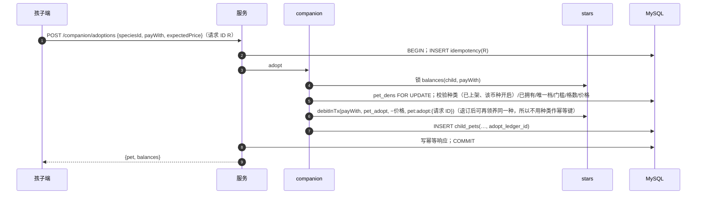

# 伙伴模块（companion）· 模块设计

> 本文为 2026-10-21 设计变更（用户已批准，见 [v1.0 变更记录](../../06-releases/v1.0/changes.md)）新增。
> 2026-10-22 回归老系统（[ADR 0020](../../adr/0020-revert-to-old-system.md)、[ADR 0021](../../adr/0021-nintendo-pets-seed.md)）：24 种种子宠物（`origin = seed`，`seeds/pets/`）与 5 档价格；种类单独定价与开关；唯一档全站一只；领养门槛 `companion.unlock_stars`（默认 0）；改名、亲密度互动（`pet_interactions`）、退订（返还一半）、赠送（`pet_gifts`）；营地扩建 10/20/100/200/500；成长装扮叠加层。

## 职责

档位与成长阶段、种子宠物导入、伙伴种类的设计与上架、领养（星星或碎片）、营地扩建、跟随伙伴经验与升级、改名、亲密度互动、退订与赠送。

## 拥有的表

pet_tiers, pet_tier_stages, pet_species, pet_dens, child_pets, pet_interactions, pet_gifts（7 张）

列与约束见 [数据模型 §6.1](../data-model.md#61-表清单82-张)。

## 边界

- 其他模块只能通过本模块的 `index.ts` 调用它（[§3.4](../../02-solution/overview.md#34-模块与边界规则) 边界规则）；`repo.ts` 只访问上面列出的表。
- 计划文件：`apps/api/src/modules/companion/` 下的 `index.ts`、`routes.ts`、`service.ts`、`repo.ts`；单元测试在 `apps/api/test/unit/companion/`。
- 依赖：stars（扣费、返还、学习星累计）、studio（设计任务与素材）、family（信箱通知 `family.notifyInTx`）。被 learning 调用 `addXpInTx`；被 social 调用 `transferPetInTx`（赠送伙伴由 social 发起，与赠星一样，所以 companion 不依赖 social，没有环）与 `activePetCard`（星星伙伴列表）。
- 伙伴设计由 AI 角色执行（美术设计师 `pet-design`、配音师 `pet-voice`、质检员 `content-qa`，见 [agents.md](agents.md)）。本模块向 studio 注册内置工具：`pet.write_design`（4 张候选、阶段图与动作关键帧写入种类草稿）、`pet.write_voice`（台词音频：Piper + ffmpeg 变调，本机进程类）、`pet.read_design`。**没有上架类工具**，审核上架仍由系统管理员操作。

## 接口

以 TypeScript 签名表示（省略 `Promise<>`；`P` = 已鉴权主体 Principal；`Tx` = Kysely 事务）。

```ts
// 孩子端
listAdoptable(child): {species, origin, tier, starPrice, fragmentPrice, starEnabled, fragmentEnabled, thresholdMet, owned, uniqueTaken}[]   // 种类单独价优先于档位价
getDen(child): {slots, used, nextExpansionPrice | null, pets: ChildPetView[]}
adopt(child, {speciesId, payWith, expectedPrice}): ChildPetView
expandDen(child, {expectedPrice}): DenView
setCompanion(child, childPetId)
rename(child, childPetId, {name, version})                  // 1–12 字，过滤个人信息
interact(child, childPetId, action: 'pet' | 'feed' | 'play'): {affection}   // 每种每天一次，亲密度 ≤ 100，不发货币
refund(child, childPetId): {refunded, currency}            // 实付一半；受赠或跟随中不可退
transferPetInTx(tx, {fromChild, childPetId, toChild, friendshipId?}): ChildPetView   // 由 social.giftPet 调用；新行复制等级 / 经验 / 亲密度 / 名字；原行 status = gifted
activePetCard(familyId, childId): PetCard | null
addXpInTx(tx, {familyId, childId, amount}): {levelUps: number, newStage?: StageName} | null   // 无跟随伙伴返回 null
// 后台
listTiers() / updateTier(admin, id, patch & {version}) / updateStages(admin, tierId, stages[], version)
updateSpecies(admin, id, {starPrice?, fragmentPrice?, starEnabled, fragmentEnabled, giftEnabled, status, version})   // 种子与原创都适用
applyPetSeeds(tx, seedFile): {inserted, updated}            // xingya seeds:apply 调用；origin = seed 的行只允许更新名称、描述、图片
createSpeciesDraft(admin, {name, description, styleTemplate}): SpeciesId
requestCandidates(admin, speciesId, {description, styleTemplate}): {runId, estimateFen}   // = studio.startTask(美术设计师, pet-design)
chooseBase(admin, speciesId, assetId)
requestStageArt(admin, speciesId): {runId, estimateFen}
setMotions(admin, speciesId, {idle, happy, cheer, extra[]})         // 选择预设动效模板
requestVoice(admin, speciesId, {voiceId, pitch, lines: {greeting, encourage, levelUp}}): {runId}   // 配音师 pet-voice
submitSpecies / reviewSpecies / publishSpecies(admin, speciesId, {tierId, version}) / unlistSpecies
```

## 规则实现
- **领养**（一个事务）：`SELECT balances(child, star|fragment) FOR UPDATE` → `pet_dens` 行（无则插入）`FOR UPDATE` → 检查：种类 `published` 且该币种开启、未拥有、唯一档未被占（`409 PET_UNIQUE_TAKEN`）、`stars.learningStarsTotal ≥ companion.unlock_stars`、`已领养数 < den_base_slots + extra_slots`、当前价格 = `expectedPrice` → `debitInTx(currency, pet_adopt, −价格, pet:adopt:{请求 ID})` → `INSERT child_pets(adopt_ledger_id)`；第一只自动 `is_companion = 1`。
- **种子宠物**：`seeds/pets/pets.json` 的每一条按 `species_key` 插入缺失的 `pet_species`（`origin = seed`、`status = published`、无创建人与审核人，数据库 CHECK 允许）；图片上传到 OSS `pub/pets/<speciesKey>.svg`。已存在的行只更新名称、描述与图片（后台改过的价格与开关不覆盖）。设计数据 `design` 只有 `baseAssetId` 与问候语，成长阶段形象 = 基础图 + 客户端叠加层（20 级围巾、50 级徽章、100 级光环，旧系统 `PetAvatar.jsx`）。AI 工作室不能为 `origin = seed` 的种类发起设计任务。
- **退订**：`child_pets FOR UPDATE`；`acquired_via = 'gift'` → `409 PET_NOT_REFUNDABLE`（ADR 0020 R4，数据库 CHECK 兜底）；跟随中 → `409 PET_IS_ACTIVE`；`creditInTx(adopted_with, pet_refund, ⌊price_paid / 2⌋, pet:refund:{childPetId})`（为 0 时不写流水，只改状态），`status = refunded`、`ended_at`；之后可再领养同一种（生成列唯一键只看 active 行）。
- **赠送**：同一事务按 `child_id` 升序锁双方的 `pet_dens` 与伙伴行；检查种类 `gift_enabled`、对方营地有空格且无同种（`409 DEN_FULL` / `PET_NOT_GIFTABLE`）（跨家庭前提由调用方 social 先校验）；原行 `status = gifted`，插入受赠方新行（`acquired_via = gift`、`gifted_from_pet_id`）与 `pet_gifts`；唯一档由 `uq_child_pets_unique` 保证全站一只（原行先改状态再插入）；双方各写一条信箱通知。
- **互动**：`INSERT pet_interactions(child_pet_id, local_date, action)`，主键冲突 → `409 PET_INTERACTED_TODAY`；成功则 `affection = LEAST(100, affection + 1)`。
- **扩建**：`extra_slots = n` 时价格取 `den_slot_prices[n]`，超出数组 → `409 DEN_MAX`；`debitInTx(star, den_expand, source_key = den:expand:{n+1})`；`extra_slots + 1`（乐观锁 `version`）。
- **经验**：`addXpInTx` 锁跟随伙伴行，`xp += amount`，循环：`need = xp_base + xp_step × ⌊(level − 1) / 10⌋ + ⌊(level − 1)² / xp_quad_div⌋`（默认 2 / 1 / 200 = 旧系统曲线，最高 100 级），`xp ≥ need` 则 `xp −= need, level + 1`，直到 `max_level`（满级后经验只累计 `total_xp`）。返回升级次数与新阶段（阶段 = `min_level ≤ level` 的最大 `stage_no`），客户端据此播放升级台词与换形象。
- **设计数据** `pet_species.design`（JSON）：`{baseAssetId, stages: [{stageNo, imageAssetId, actions: {idle, happy, cheer, …: animationAssetId}}], lines: {greeting, encourage, levelUp: audioAssetId}}`。动画素材是 JSON 清单：`{keyframes: [assetId…], template: "bounce", durationMs, loop}`，由前端动效播放器渲染。
- **提示词**：`description` + 风格模板片段 + 自动追加的禁止项；先用 `seeds/safety/prompt-blocklist` 检查描述与名称。

## 时序：领养



## 端点

见 [API 概要 §5.3](../api.md#53-端点按模块) 中“companion”与“admin/studio/pets”两组。

## 需求

见 [伙伴 · 需求](../../01-requirements/modules/companion.md)。
