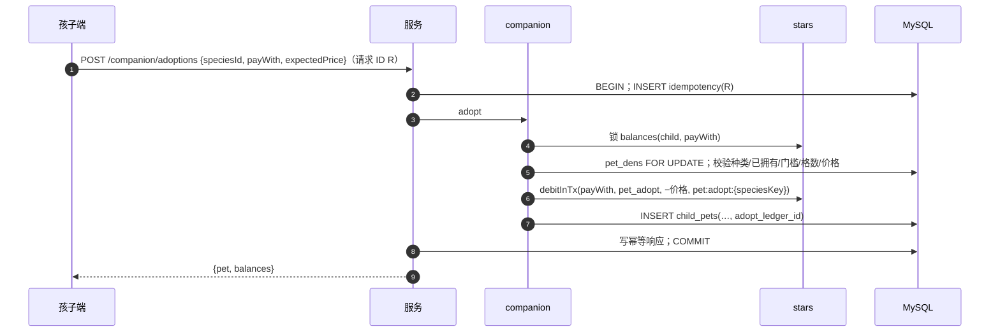

# 学习伙伴（companion）· 模块设计

> 本文为 2026-10-21 设计变更（用户已批准，见 [v1.0 变更记录](../../06-releases/v1.0/changes.md)）新增。

## 职责

档位与成长阶段、伙伴种类的设计与上架、领养（星星或碎片）、营地扩建、学习陪伴经验与升级。

## 拥有的表

pet_tiers, pet_tier_stages, pet_species, pet_dens, child_pets

列与约束见 [数据模型 §6.1](../data-model.md#61-表清单65-张)。

## 边界

- 其他模块只能通过本模块的 `index.ts` 调用它（[§3.4](../../02-solution/overview.md#34-模块与边界规则) 边界规则）；`repo.ts` 只访问上面列出的表。
- 计划文件：`apps/api/src/modules/companion/` 下的 `index.ts`、`routes.ts`、`service.ts`、`repo.ts`；单元测试在 `apps/api/test/unit/companion/`。
- 依赖：stars（扣费、学习星累计）、studio（设计任务与素材）、family。被 learning 调用 `addXpInTx`。
- 伙伴设计由 AI 角色执行（美术设计师 `pet-design`、配音师 `pet-voice`、质检员 `content-qa`，见 [agents.md](agents.md)）。本模块向 studio 注册内置工具：`pet.write_design`（4 张候选、阶段图与动作关键帧写入种类草稿）、`pet.write_voice`（台词音频：Piper + ffmpeg 变调，本机进程类）、`pet.read_design`。**没有上架类工具**，审核上架仍由管理员操作。

## 接口

以 TypeScript 签名表示（省略 `Promise<>`；`P` = 已鉴权主体 Principal；`Tx` = Kysely 事务）。

```ts
// 孩子端
listAdoptable(child): {species, tier, starPrice, fragmentPrice, thresholdMet, owned}[]
getDen(child): {slots, used, nextExpansionPrice | null, pets: ChildPetView[]}
adopt(child, {speciesId, payWith, expectedPrice}): ChildPetView
expandDen(child, {expectedPrice}): DenView
setCompanion(child, childPetId)
addXpInTx(tx, {familyId, childId, amount}): {levelUps: number, newStage?: StageName} | null   // 无陪伴返回 null
// 后台
listTiers() / updateTier(admin, id, patch & {version}) / updateStages(admin, tierId, stages[], version)
createSpeciesDraft(admin, {name, description, styleTemplate}): SpeciesId
requestCandidates(admin, speciesId, {description, styleTemplate}): {runId, estimateFen}   // = studio.startTask(美术设计师, pet-design)
chooseBase(admin, speciesId, assetId)
requestStageArt(admin, speciesId): {runId, estimateFen}
setMotions(admin, speciesId, {idle, happy, cheer, extra[]})         // 选择预设动效模板
requestVoice(admin, speciesId, {voiceId, pitch, lines: {greeting, encourage, levelUp}}): {runId}   // 配音师 pet-voice
submitSpecies / reviewSpecies / publishSpecies(admin, speciesId, {tierId, version}) / unlistSpecies
```

## 规则实现
- **领养**（一个事务）：`SELECT balances(child, star|fragment) FOR UPDATE` → `pet_dens` 行（无则插入）`FOR UPDATE` → 检查：种类 `published`、未拥有、`stars.learningStarsTotal ≥ tier.adoption_threshold`、`已领养数 < den_base_slots + extra_slots`、当前价格 = `expectedPrice` → `debitInTx(currency, pet_adopt, −价格, pet:adopt:{speciesKey})` → `INSERT child_pets(adopt_ledger_id)`；第一只自动 `is_companion = 1`。
- **扩建**：`extra_slots = n` 时价格取 `den_slot_prices[n]`，超出数组 → `409 DEN_MAX`；`debitInTx(star, den_expand, source_key = den:expand:{n+1})`；`extra_slots + 1`（乐观锁 `version`）。
- **经验**：`addXpInTx` 锁当前陪伴行，`xp += amount`，循环：`need = xp_base + xp_step × (level − 1)`，`xp ≥ need` 则 `xp −= need, level + 1`，直到 `max_level`（满级后经验只累计 `total_xp`）。返回升级次数与新阶段（阶段 = `min_level ≤ level` 的最大 `stage_no`），客户端据此播放升级台词与换形象。
- **设计数据** `pet_species.design`（JSON）：`{baseAssetId, stages: [{stageNo, imageAssetId, actions: {idle, happy, cheer, …: animationAssetId}}], lines: {greeting, encourage, levelUp: audioAssetId}}`。动画素材是 JSON 清单：`{keyframes: [assetId…], template: "bounce", durationMs, loop}`，由前端动效播放器渲染。
- **提示词**：`description` + 风格模板片段 + 自动追加的禁止项；先用 `seeds/safety/prompt-blocklist` 检查描述与名称。

## 时序：领养



## 端点

见 [API 概要 §5.3](../api.md#53-端点按模块) 中“companion”与“admin/studio/pets”两组。

## 需求

见 [学习伙伴 · 需求](../../01-requirements/modules/companion.md)。
