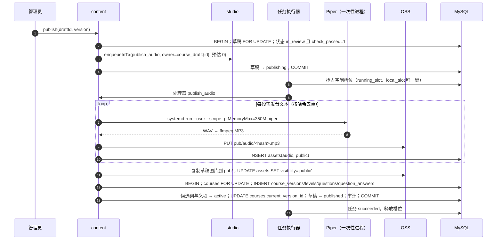

# 课程内容（content）· 模块设计

> 本文由已确认的《星芽学园全新系统设计规格》（2026-10-21，提交 6b463ed）拆分而来；章节编号沿用原规格，便于交叉引用（编号与文件的对应见 [docs/README.md](../../README.md)）。
> 2026-10-21 设计变更（用户已批准，见 [v1.0 变更记录](../../06-releases/v1.0/changes.md)）：从“内存中的只读课程包”改为数据库中的版本化课程 + 共享词库 + 草稿生命周期（[ADR 0008](../../adr/0008-db-versioned-courses-word-bank.md)）。

## 职责

共享词库；课程、草稿、不可变版本；表单编辑、自动检查（K1–K12）、学生视角试玩、审核、发布；题型判分器；模板注册（读取仓库 `content/templates/`）；内存中的头像、短语/表情、安全词表。

## 拥有的表

words, word_senses, courses, course_versions, course_drafts, levels, questions, question_answers

列与约束见 [数据模型 §6.1](../data-model.md#61-表清单65-张)；文档结构、题型两部分、K 规则与发布流程见 [课程模型](../course-model.md)。

## 边界

- 其他模块只能通过本模块的 `index.ts` 调用它（[§3.4](../../02-solution/overview.md#34-模块与边界规则) 边界规则）；`repo.ts` 只访问上面列出的表。
- 计划文件：`apps/api/src/modules/content/` 下的 `index.ts`、`routes.ts`、`service.ts`、`repo.ts`、`*.test.ts`。
- 依赖：studio（生成与发布任务、素材）、family（管理员）。AI 流程由 AI 角色执行（课程设计师的技能 `course-analyze`、`course-generate`、`question-rewrite`；美术设计师 `course-illustration`；配音师 `course-voice`；质检员 `content-qa`，见 [agents.md](agents.md)）。本模块向 studio 注册内置工具：`materials.read`、`words.search`、`templates.read`、`courses.list`、`course.read_draft`、`course.write_draft`（只写草稿，每次写入都跑 K 规则）、`course.rewrite_question`、`course.attach_images`、`course.assign_voices`（写对话声音分配并生成试听音频）、`course.run_checks`；以及系统任务处理器 `publish_audio`（发布，确定性，复用试听音频的哈希）。**没有发布类工具**。

## 接口

以 TypeScript 签名表示（省略 `Promise<>`；`P` = 已鉴权主体 Principal；`Tx` = Kysely 事务）。

```ts
// 孩子端读取（只读已发布版本）
currentVersion(courseId): CourseVersion | null
listCourses(filter: {subject?, grade?}): CourseSummary[]          // 只含有当前版本且未退役的课程
getLevel(versionId, levelId): LevelVisible                          // 关卡 + 题目可见部分（不含答案）
levelSequence(versionId): {levelId, levelKey, seq}[]
gradeInTx(tx, questionId, response): {correct, reveal: {answer, explanation}}  // 读 question_answers 判分
levelSenses(levelId): SenseId[]                                     // 该关考查的义项
pickDistractorSenses(senseId, n, seed): SenseId[]                  // 复习生成题：同学科同年级已发布义项，确定性
spotDefinitions(levelId): {kind, x, y}[]                          // 3 个藏匿点
// 词库
getSense(id) / searchWords(q) / createDraftWordInTx(tx, …) / retireSense(admin, id)
setWordAudio(admin, wordId, assetId) / setSenseImage(admin, senseId, assetId)
// 后台课程
createCourse(admin, {id, subject, grade, sortOrder, templateId})
openDraft(admin, courseId, {fromVersionId?}): Draft              // 每门课最多一份未完成草稿
updateDraft(admin, draftId, patch & {version}): {draft, checkReport}  // 每次保存都跑 K 规则
requestAiRewrite(admin, draftId, questionKey, hint?): RunId        // = studio.startTask(课程设计师, question-rewrite)
previewLevel(admin, draftId, levelKey): LevelVisible               // 学生视角试玩（不记录）
submitForReview(admin, draftId, version) / returnToDraft(admin, draftId, reason)
publish(admin, draftId, version): JobId                            // 入队 publish_audio
importSample(file): DraftId                                        // xingya course:import
listTemplates(): Template[] / getTemplate(id, version)
avatars() / phrases() / emojis() / safetyLists()
```

## 时序：发布



## 端点

见 [API 概要 §5.3](../api.md#53-端点按模块) 中“content / learning”与“admin/studio/courses”两组。

## 需求

见 [课程内容 · 需求](../../01-requirements/modules/content.md)、[AI 生成课程 · 需求](../../01-requirements/modules/studio.md#48-ai-生成课程)。
