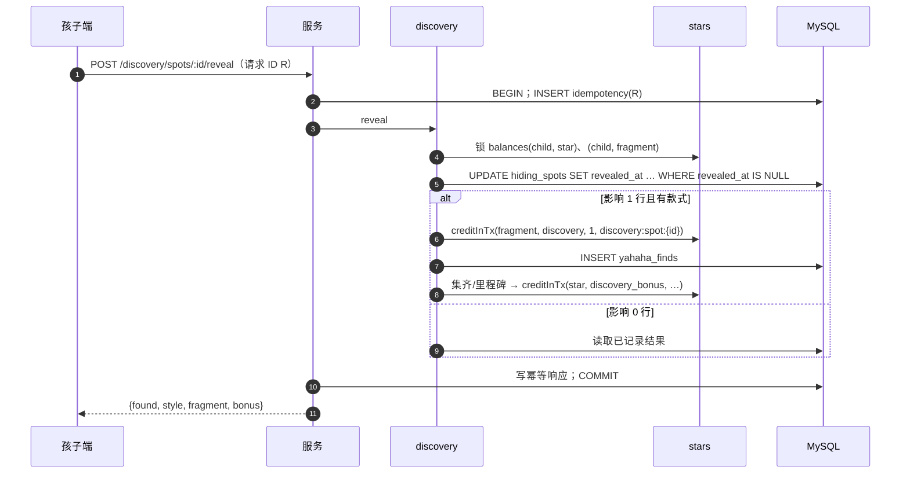

# 呀哈哈发现（discovery）· 模块设计

> 本文为 2026-10-21 设计变更（用户已批准，见 [v1.0 变更记录](../../06-releases/v1.0/changes.md)）新增。决策见 [ADR 0012](../../adr/0012-server-decided-discovery-ai-filled-rules.md)。

## 职责

通关结算时放置藏匿点、揭晓、图鉴与奖励、款式与套组、全局设置、投放规则（表单 / AI 填写、复述、影响估算、重叠检查、生命周期、审计）、统计。

## 拥有的表

yahaha_sets, yahaha_styles, drop_rules, hiding_spots, yahaha_finds

列与约束见 [数据模型 §6.1](../data-model.md#61-表清单65-张)。审计写入 family 的 `audit_events`（`target_type = 'drop_rule' | 'yahaha_style' | 'discovery_settings'`），没有单独的审计表。

## 边界

- 其他模块只能通过本模块的 `index.ts` 调用它（[§3.4](../../02-solution/overview.md#34-模块与边界规则) 边界规则）；`repo.ts` 只访问上面列出的表。
- 计划文件：`apps/api/src/modules/discovery/` 下的 `index.ts`、`routes.ts`、`service.ts`、`repo.ts`、`*.test.ts`。
- 依赖：stars（碎片与奖励星）、content（课程/关卡范围校验、藏匿点定义）、studio（款式设计、规则填写任务）、family（审计）。被 learning 调用 `placeSpotsInTx`。
- 款式设计与规则填写由 AI 角色执行（美术设计师 `yahaha-style-design`、配音师 `yahaha-voice`、质检员 `content-qa`、活动策划 `drop-rule-fill` / `campaign-plan`，见 [agents.md](agents.md)）。本模块向 studio 注册内置工具：`styles.read`、`yahaha.write_style`（候选与关键帧写入款式草稿）、`yahaha.write_voice`、`yahaha.read_style`、`rules.read`、`rule.write_draft`（只写 RuleSpec 草稿，不生效）、`rule.estimate_impact`。**没有发布、生效类工具**。

## 接口

以 TypeScript 签名表示（省略 `Promise<>`；`P` = 已鉴权主体 Principal；`Tx` = Kysely 事务）。

```ts
placeSpotsInTx(tx, {attempt, child, courseId, levelKey, grade, trigger}): SpotView[3]   // 只返回编号、种类、位置
leftToday(child): number                                                               // “今天还能找 N 个”
reveal(child, spotId): {found: false} | {found: true, style, fragment, bonus[]}
getAlbum(child): {sets: [{set, styles: [{style | silhouette, count}]}], total}
// 后台
getSettings() / updateSettings(admin, {enabled, probabilityPct, dailyCap, rarityWeights, milestoneBonus} & {version})
upsertSet / styleDesign…（与伙伴相同的候选 → 选定 → 关键帧 → 动效 → 叫声 → 审核 → 发布）
updateStyle(admin, id, {rarity, perChildMax, totalStock, status} & {version})
parseRule(admin, text): {runId, estimateFen}                 // = studio.startTask(活动策划, drop-rule-fill)；结果是 RuleSpec 草稿，不生效
validateRule(spec): {errors[], restatement, impact, overlaps[]}
saveRule(admin, spec & {version}) / publishRule / pauseRule / resumeRule
stats(range): DiscoveryStats
```

## 规则结构（RuleSpec，Zod 严格模式；AI 与表单填写同一结构）
```jsonc
{
  "name": "国庆森林周",
  "type": "campaign",                         // campaign | course
  "startsAt": "2026-10-01T00:00:00+08:00", "endsAt": "2026-10-08T00:00:00+08:00",   // campaign 必填 endsAt
  "audience": { "grades": [1] },              // 空 = 全部孩子
  "scope": { "courseIds": ["en-g1-u03"], "levelKeys": [] },   // course 类型 courseIds ≥ 1
  "trigger": { "kind": "level_pass" },        // level_pass | unit_first_all_three_star | specific_level_pass{levelKey} | streak_days{days 2–60}
  "effect": { "kind": "raise_probability", "probabilityPct": 40 },   // raise_probability{1–100} | restrict_styles | guaranteed
  "styleIds": [3, 4, 5],                       // 可空 = 全部已上架；restrict_styles 时必填
  "dailyCap": 4,                               // 1–10，可空 = 用全局
  "totalQuantity": 500                         // ≥ 1，可空 = 不限
}
```
- 校验（服务端，先于数据库 CHECK）：类型与触发/效果的组合（限时活动只能“通关”+ 提高概率/限定款式；课程规则只能 首次全三星/指定关卡/连续 N 天/通关 + 必得/提高概率）；概率 1–100；每日上限 1–10；总量 ≥ 1；`endsAt > startsAt`；课程与关卡存在；款式已上架；年级 1–6。AI 输出不合模式 → 任务失败并显示原因，不保存。
- **复述**由固定模板生成（不经 AI），例如：“10 月 1 日 0:00 到 10 月 8 日 0:00，一年级孩子在 Unit 3 通关时，每个藏匿点有 40% 的机会出现呀哈哈，只会出现森林套组的 3 种；每人每天最多 4 个；整个活动最多 500 个。”
- **影响估算**：取近 14 天数据，`每日通关次数 r`（受众内每孩子平均）、受众孩子数 `n`、天数 `d`：每孩子每天预计放置 `min(3 × r × p_rule, cap)`，相比全局默认多出 `min(3 × r × p_rule, cap) − min(3 × r × p_global, cap_global)`；期间预计消耗 `min(n × d × 每孩子每天预计放置, totalQuantity)`；必得类按触发条件近 14 天的发生次数估算。
- **重叠**：时间窗相交且受众/课程范围相交的已发布规则列入 `overlaps`，发布前必须确认。

## 放置算法（`placeSpotsInTx`，在结算事务内）
1. `discovery.enabled = false` → 3 个空藏匿点。
2. 收集适用规则：`status = published`、当前在时间窗内、受众与课程/关卡匹配、触发条件满足（由 learning 传入 `trigger`：是否单元首次全三星、关卡键、连续天数）、总量未用完。
3. 合并：`p = max(全局概率, 各规则 probabilityPct)`；`cap = min(全局上限, 各规则 dailyCap)`；限定款式取交集（为空时取概率最高那条规则的款式）；任一规则为“必得”则 `guaranteed = true`。
4. 款式池：已上架款式 ∩ 限定 − 已达 `per_child_max` 的 − `placed_total = total_stock` 的。池为空 → 全部为空藏匿点。
5. 计算今天已放置数 `used`（`SELECT MAX(daily_seq) … FOR UPDATE` on 该孩子当天的藏匿点）；可放置 `room = cap − used`。
6. 对 3 个藏匿点依次：`room > 0` 且 `crypto.randomInt(100) < p` → 按稀有度权重抽款式；`guaranteed` 且三个都未命中且 `room > 0` → 第 1 个藏匿点强制放置。每放置一个：`daily_seq = used + 1`（唯一键 + CHECK ≤ 10 兜底）、款式 `placed_total + 1`（CHECK ≤ total_stock 兜底）、记录 `rule_id`（概率或必得来源的规则），规则 `consumed_quantity + 1`（CHECK ≤ total_quantity 兜底）。
7. 插入 3 行 `hiding_spots`（`(attempt_id, spot_no)` 唯一，重复结算不会重复放置）。

## 揭晓
`UPDATE hiding_spots SET revealed_at = NOW(3) WHERE id = ? AND child_id = ? AND revealed_at IS NULL`：影响 1 行 → 首次揭晓：空的直接返回；有款式的在同一事务内 `stars.creditInTx(fragment, discovery, 1, discovery:spot:{id})` → `INSERT yahaha_finds` → 检查套组集齐（`discovery:set:{setId}`，奖励 `yahaha_sets.bonus_stars`）与累计里程碑（`discovery:total:{10|30|100}`，奖励 `discovery.milestone_bonus`），用 `discovery_bonus` 发星。影响 0 行 → 返回已记录结果（不发放）。不属于该孩子 → 404。

## 时序：揭晓



## 端点

见 [API 概要 §5.3](../api.md#53-端点按模块) 中“discovery”与“admin/studio/yahaha、rules”两组。

## 需求

见 [呀哈哈发现 · 需求](../../01-requirements/modules/discovery.md)。
