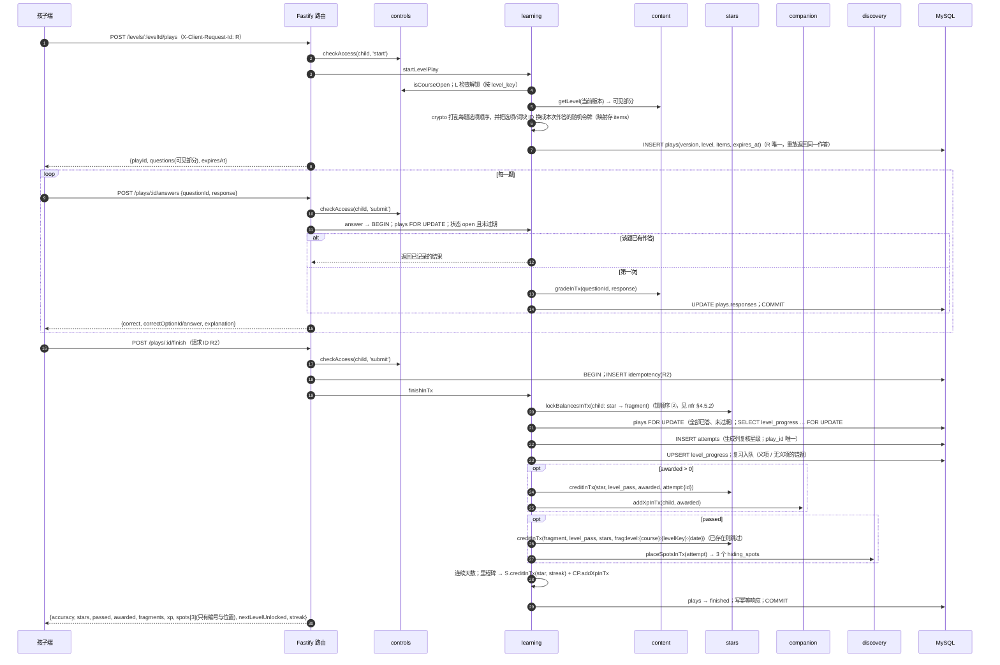

# 学习（learning）· 模块设计

> 本文由已确认的《星芽学园全新系统设计规格》（2026-10-21，提交 6b463ed）拆分而来；章节编号沿用原规格，便于交叉引用（编号与文件的对应见 [docs/README.md](../../README.md)）。
> 2026-10-21 设计变更（用户已批准，见 [v1.0 变更记录](../../06-releases/v1.0/changes.md)）：整批提交改为作答（plays）三步：开始（只下发可见部分）→ 逐题作答（服务端判分反馈）→ 完成（一次结算，含碎片、伙伴经验、藏匿点）。

## 职责

关卡路线与解锁、作答、最佳成绩、义项与错题的间隔复习、连续学习天数。

## 拥有的表

plays, level_progress, attempts, review_items, review_sessions

列与约束见 [数据模型 §6.1](../data-model.md#61-表清单65-张)。

## 边界

- 其他模块只能通过本模块的 `index.ts` 调用它（[§3.4](../../02-solution/overview.md#34-模块与边界规则) 边界规则）；`repo.ts` 只访问上面列出的表。
- 计划文件：`apps/api/src/modules/learning/` 下的 `index.ts`、`routes.ts`、`service.ts`、`repo.ts`；单元测试在 `apps/api/test/unit/learning/`。
- 依赖：controls（开放与时长）、content（版本、题目、判分）、stars（星星与碎片）、companion（经验）、discovery（藏匿点）、studio（启动时注册呀哈哈队长的只读工具 `child.learned_words`：只返回会话孩子已学的义项文本与中文释义，最多 50 个，无参数，见 [agents.md](agents.md#工具目录v10)）。

## 接口

以 TypeScript 签名表示（省略 `Promise<>`；`P` = 已鉴权主体 Principal；`Tx` = Kysely 事务）。

```ts
getCourseMap(child, courseId): {levels: LevelState[], yahahaLeftToday}   // locked | open | passed(stars)；按 level_key
startLevelPlay(child, levelId, requestId): PlayView                         // 可见题目、打乱后的选项、素材 CDN 地址
startReviewPlay(child, requestId): PlayView                                 // ≤ 20 − 今日已复习
answer(child, playId, {questionRef, response}): {correct?, reveal?}      // 每题只记第一次
finish(child, playId): AttemptResult | ReviewResult                         // 幂等：重复返回第一次的结果
getReviewSummary(child): {dueToday, doneToday, remainingToday, completedToday}
getStreak(child): {current, longest, todayCounts}
statsForDay(familyId, childId, date): LearningDayStats                      // 供 reports 聚合
expirePlays(now) / purgeExpiredPlays(now)                                   // 调度任务
```

- `plays.items` 记录本次下发的题目 ID（或复习生成题的义项与选项）以及每题的选项顺序；`plays.responses` 按题记录第一次作答与对错。`answer` 在 `plays` 行锁内检查“该题已有作答则直接返回已记录结果”。
- 有效期：`expires_at = started_at + learning.play_ttl_minutes`（默认 120）。
- 完成要求全部题目已作答（`409 PLAY_INCOMPLETE`）。

## 时序：开始 → 作答 → 完成



复习作答相同：`POST /review/plays` 开始，同样的 `answers` 与 `finish`；完成时写 `review_sessions`（`play_id` 唯一）、更新盒与到期日；“今日完成”时发 `star review_day 2` 与 `fragment review_day 2` 并 `addXpInTx(2)`。

## 端点

见 [API 概要 §5.3](../api.md#53-端点按模块) 中“content / learning”一组。

## 需求

见 [学习 · 需求](../../01-requirements/modules/learning.md)。
