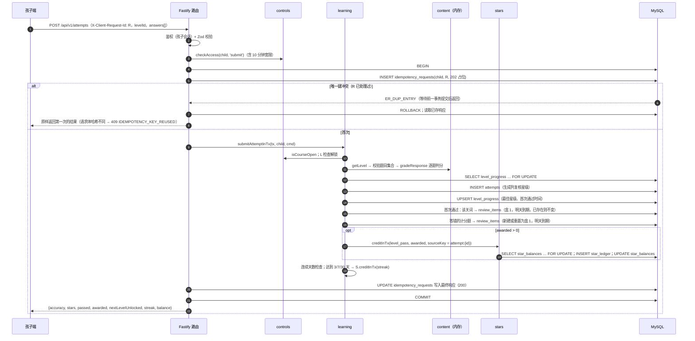

# 学习（learning）· 模块设计

> 本文由已确认的《星芽学园全新系统设计规格》（2026-10-21，提交 6b463ed）拆分而来；章节编号沿用原规格，便于交叉引用（编号与文件的对应见 [docs/README.md](../../README.md)）。


## 职责

关卡路线与解锁、整批提交闯关与判分、最佳成绩、错题与词的间隔复习、连续学习天数。

## 拥有的表

level_progress, attempts, review_items, review_sessions

列与约束见 [数据模型 [§6.1](../data-model.md)](../data-model.md)。

## 边界

- 其他模块只能通过本模块的 `index.ts` 调用它（[§3.4](../../02-solution/overview.md) 边界规则）；`repo.ts` 只访问上面列出的表。
- 计划文件：`apps/api/src/modules/learning/` 下的 `index.ts`、`routes.ts`、`service.ts`、`repo.ts`、`*.test.ts`。

## 接口（原 §3.5）

以 TypeScript 签名表示（省略 `Promise<>`；`P` = 已鉴权主体 Principal；`Tx` = Kysely 事务）。

**learning**

```ts
getCourseMap(child, courseId): LevelState[]           // locked | open | passed(stars)
getLevelForPlay(child, levelId): PlayableLevel        // 检查开放、解锁、时长
submitAttempt(child, cmd: {levelId, clientStartedAt?, answers[]}): AttemptResult
getReviewSummary(child): {dueToday, doneToday, remainingToday, completedToday}
getReviewBatch(child): ReviewQuestion[]               // ≤ 20 - doneToday
submitReview(child, cmd: {items[]}): ReviewResult
getStreak(child): {current, longest, todayCounts}
statsForDay(familyId, childId, date): LearningDayStats  // 供 reports 聚合
```

## 时序



## 端点

见 [API 概要 [§5.3](../api.md)](../api.md) 中“content / learning”一组。

## 需求

见 [学习 · 需求](../../01-requirements/modules/learning.md)。
