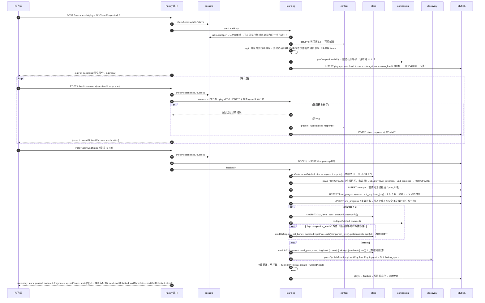

# 学习（learning）· 模块设计

> 本文由已确认的《星芽学园全新系统设计规格》（2026-10-21，提交 6b463ed）拆分而来；章节编号沿用原规格，便于交叉引用（编号与文件的对应见 [docs/README.md](../../README.md)）。
> 2026-10-21 设计变更（用户已批准，见 [v1.0 变更记录](../../06-releases/v1.0/changes.md)）：整批提交改为作答（plays）三步：开始（只下发可见部分）→ 逐题作答（服务端判分反馈）→ 完成（一次结算，含碎片、伙伴经验、藏匿点）。
> 2026-10-21 单元层（[ADR 0016](../../adr/0016-unit-layer.md)）：路线图按单元分组；单元在课程内、关卡在单元内顺序解锁；进度键改为 `(course_id, unit_key, level_key)`；新增 `unit_progress`。

## 职责

课程路线图（单元 > 关卡）与解锁、单元进度、作答、最佳星级、义项与错题的间隔复习、连续学习天数。

## 拥有的表

plays, level_progress, unit_progress, attempts, review_items, review_sessions

列与约束见 [数据模型 §6.1](../data-model.md#61-表清单67-张)。

## 边界

- 其他模块只能通过本模块的 `index.ts` 调用它（[§3.4](../../02-solution/overview.md#34-模块与边界规则) 边界规则）；`repo.ts` 只访问上面列出的表。
- 计划文件：`apps/api/src/modules/learning/` 下的 `index.ts`、`routes.ts`、`service.ts`、`repo.ts`；单元测试在 `apps/api/test/unit/learning/`。
- 依赖：controls（开放与时长）、content（版本、题目、判分）、stars（星星与碎片）、companion（经验）、discovery（藏匿点）、studio（启动时注册呀哈哈队长的只读工具 `child.learned_words`：只返回会话孩子已学的义项文本与中文释义，最多 50 个，无参数，见 [agents.md](agents.md#工具目录v10)）。

## 接口

以 TypeScript 签名表示（省略 `Promise<>`；`P` = 已鉴权主体 Principal；`Tx` = Kysely 事务）。

```ts
getCourseMap(child, courseId): {units: UnitState[], yahahaLeftToday}   // 单元 locked | open | completed，含 levels: LevelState[]（locked | open | passed(stars)）；按 (unit_key, level_key)
startLevelPlay(child, levelId, requestId): PlayView                         // 可见题目、打乱后的选项、素材 CDN 地址
startReviewPlay(child, requestId): PlayView                                 // ≤ 20 − 今日已复习
answer(child, playId, {questionRef, response}): {correct?, reveal?}      // 每题只记第一次
finish(child, playId): AttemptResult | ReviewResult                         // 幂等：重复返回第一次的结果
getReviewSummary(child): {dueToday, doneToday, remainingToday, completedToday}
getStreak(child): {current, longest, todayCounts}
statsForDay(familyId, childId, date): LearningDayStats                      // 供 reports 聚合（含首次完成单元数）
unitProgress(familyId, childId): UnitProgressView[]                         // 供家长中心与周报：各课程各单元进度
expirePlays(now) / purgeExpiredPlays(now)                                   // 调度任务
```

- `plays.items` 记录本次下发的题目 ID（或复习生成题的义项与选项）以及每题的选项顺序；`plays.responses` 按题记录第一次作答与对错。`answer` 在 `plays` 行锁内检查“该题已有作答则直接返回已记录结果”。
- 有效期：`expires_at = started_at + learning.play_ttl_minutes`（默认 120）。
- 完成要求全部题目已作答（`409 PLAY_INCOMPLETE`）。
- **解锁**（按当前版本 `courseOutline`）：第 1 单元第 1 关始终可玩；单元内第 k 关在第 k−1 关已通过后解锁；第 N+1 单元在第 N 单元已完成（`unit_progress.first_completed_at` 非空）后解锁。`first_completed_at` 一旦写入不再清除，所以新版本给已完成单元加关卡时，后面的单元不会重新锁上（新增关卡在本单元内照常按顺序解锁）。
- **单元进度**：每次通过后在同一事务内按当前版本该单元的关卡列表重算 `level_count`、`levels_passed`、`levels_three_star`；`levels_passed = level_count` 且 `first_completed_at` 为空 → 写入（返回 `unitCompleted`）；`levels_three_star = level_count` 且 `first_all_three_star_at` 为空 → 写入，并把 `trigger.unitFirstAllThreeStar = true` 传给 discovery（只触发一次）。

## 时序：开始 → 作答 → 完成



复习作答相同：`POST /review/plays` 开始，同样的 `answers` 与 `finish`；完成时写 `review_sessions`（`play_id` 唯一）、更新盒与到期日；对每个答对的条目 `creditInTx(point, review_correct, 100, review_correct:{date}:{reviewItemId})`（已存在则跳过；当天该 kind 合计达到 30 积分后不再写，在积分余额行锁内计数）；“今日完成”时只发 `fragment review_day 2`。复习不发星星、不加伙伴经验（ADR 0017）。

听发音：`POST /plays/:id/listen {target}` → BEGIN；`lockBalancesInTx(child, [point])`；`plays FOR UPDATE`；`status = 'finished'` → `409 PLAY_FINISHED`；`target` 必须能在 `plays.items` 中找到且带音频（否则 400）；`creditInTx(point, level_listen, 10, listen:{playId}:{target})`，重复返回 `{awarded:false}`；COMMIT。不经幂等表（`source_key` 已保证只发一次）。

## 端点

见 [API 概要 §5.3](../api.md#53-端点按模块) 中“content / learning”一组。

## 需求

见 [学习 · 需求](../../01-requirements/modules/learning.md)。
