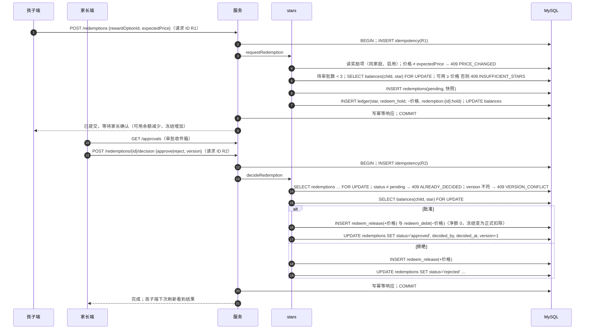

# 星星（stars）· 模块设计

> 本文由已确认的《星芽学园全新系统设计规格》（2026-10-21，提交 6b463ed）拆分而来；章节编号沿用原规格，便于交叉引用（编号与文件的对应见 [docs/README.md](../../README.md)）。
> 2026-10-21 设计变更（用户已批准，见 [v1.0 变更记录](../../06-releases/v1.0/changes.md)）：`star_ledger`/`star_balances` 改为 `ledger`/`balances`，增加 `currency`（星星、碎片，[ADR 0011](../../adr/0011-fragments-second-currency.md)）；商店物品表 `shop_items` 归本模块（只卖装扮）；伙伴移到 companion。

## 职责

只追加账本（星星与碎片）与余额缓存、发放与扣除、商店装扮购买与穿戴、家长定义的现实奖励与兑换审批、夜间对账。

## 拥有的表

ledger, balances, shop_items, child_items, reward_options, redemptions

列与约束见 [数据模型 §6.1](../data-model.md#61-表清单65-张)。

## 边界

- 其他模块只能通过本模块的 `index.ts` 调用它（[§3.4](../../02-solution/overview.md#34-模块与边界规则) 边界规则）；`repo.ts` 只访问上面列出的表。
- 计划文件：`apps/api/src/modules/stars/` 下的 `index.ts`、`routes.ts`、`service.ts`、`repo.ts`；单元测试在 `apps/api/test/unit/stars/`。
- 依赖：family（孩子、家长）、studio（装扮图片素材只读）。不依赖 content。

## 接口

以 TypeScript 签名表示（省略 `Promise<>`；`P` = 已鉴权主体 Principal；`Tx` = Kysely 事务）。

```ts
type Currency = 'star' | 'fragment'
getBalances(childId): {stars: {available, held}, fragments}
listLedger(familyId, childId, {currency?, cursor})
creditInTx(tx, {familyId, childId, currency, kind, delta, sourceKey, localDate, actorParentId?, note?}): LedgerEntry | 'duplicate'
debitInTx(tx, …同上): LedgerEntry                    // 余额不足 → INSUFFICIENT_STARS / INSUFFICIENT_FRAGMENTS
lockBalancesInTx(tx, childId, currencies[]): void     // 按 star → fragment 顺序加行锁（不存在则插入 0 余额行）
learningStarsTotal(childId): number                  // SUM(delta) WHERE counts_for_leaderboard = 1（companion 门槛）
parentAward(p, childId, {amount, note})
listShopItems() / purchase(child, {itemId, expectedPrice}) / setEquipment(child, {slot, itemId | null}) / listOwned(childId)
adminUpsertShopItem(admin, item & {version}) / importShopSeed(file)
listRewardOptions(familyId) / createRewardOption(p, …) / updateRewardOption(p, id, patch & {version})
requestRedemption(child, {rewardOptionId, expectedPrice}) / cancelRedemption(child, id)
decideRedemption(p, id, {decision: 'approve' | 'reject', note?, version})
listPendingRedemptions(familyId)
verifyBalances(): Mismatch[]                         // 夜间对账（两个币种）
```

- `creditInTx`/`debitInTx` 在 `balances(child_id, currency)` 行锁内计算 `balance_after`；同一事务涉及两个币种时先锁 `star` 再锁 `fragment`。`source_key` 冲突返回 `'duplicate'`（调用方据此跳过，例如“同一关当天已发过碎片”）。
- 碎片的 kind 只允许 `level_pass`、`review_day`、`discovery`（入）与 `pet_adopt`（出），由数据库 CHECK 保证；接口层也拒绝其他组合。

## 时序：兑换（冻结 → 批准/拒绝）



## 端点

见 [API 概要 §5.3](../api.md#53-端点按模块) 中“stars”一组。

## 需求

见 [星星 · 需求](../../01-requirements/modules/stars.md)。
