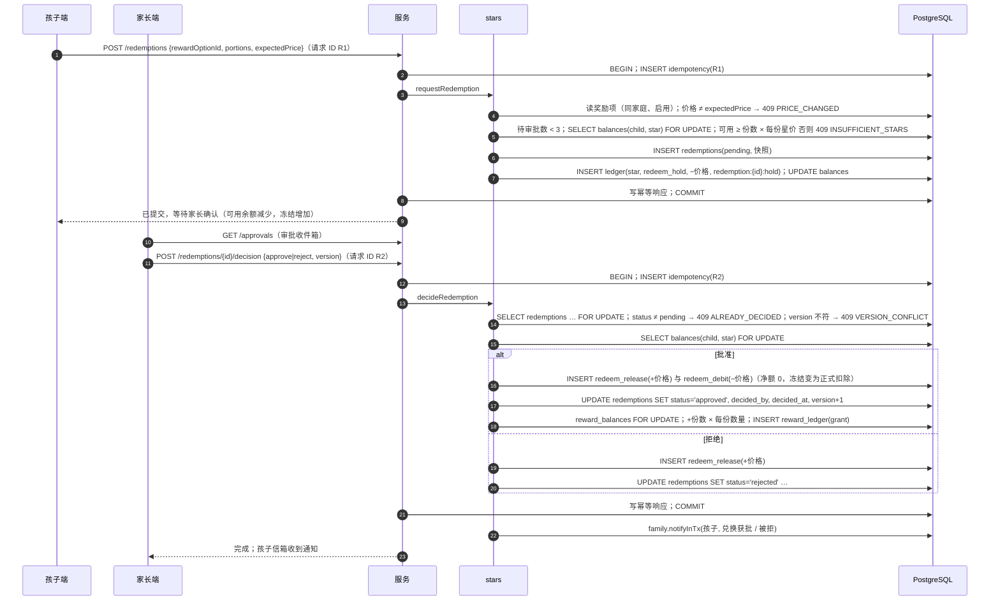

# 星星（stars）· 模块设计

> 本文由已确认的《星芽学园全新系统设计规格》（2026-10-21，提交 6b463ed）拆分而来；章节编号沿用原规格，便于交叉引用（编号与文件的对应见 [docs/README.md](../../README.md)）。
> 2026-10-21 设计变更（用户已批准，见 [v1.0 变更记录](../../06-releases/v1.0/changes.md)）：`star_ledger`/`star_balances` 改为 `ledger`/`balances`，增加 `currency`（星星、碎片，[ADR 0011](../../adr/0011-fragments-second-currency.md)）；商店物品表 `shop_items` 归本模块（只卖装扮）；伙伴移到 companion。
> 2026-10-22 回归老系统（[ADR 0020](../../adr/0020-revert-to-old-system.md)）：装扮改为**探险徽章**（同时只佩戴一枚）；星星小铺四卡；现实奖励按份兑换，获批后记入**累计奖励**（`reward_balances` + 只追加 `reward_ledger`，孩子用掉、家长核销）；家长加星 1–1000000 与扣星（必须写原因）；星级荣誉；星星新增 `hidden_reward`、`secret_entry`、`secret_reward`、`pet_refund`，单词星算学习星；碎片改为 `learning_card` / `review_day` / `discovery` / `pet_refund`（通关不再发碎片）。

## 职责

只追加账本（星星、碎片与积分，ADR 0017）与余额缓存、发放与扣除、积分换星、星星小铺（探险徽章购买与佩戴）、家长定义的现实奖励、按份兑换与审批、累计奖励（用掉、核销）、家长加星与扣星、星级荣誉、夜间对账。

## 拥有的表

ledger, balances, shop_items, child_items, reward_options, redemptions, reward_balances, reward_ledger（8 张）

列与约束见 [数据模型 §6.1](../data-model.md#61-表清单82-张)。

## 边界

- 其他模块只能通过本模块的 `index.ts` 调用它（[§3.4](../../02-solution/overview.md#34-模块与边界规则) 边界规则）；`repo.ts` 只访问上面列出的表。
- 计划文件：`apps/api/src/modules/stars/` 下的 `index.ts`、`routes.ts`、`service.ts`、`repo.ts`；单元测试在 `apps/api/test/unit/stars/`。
- 依赖：family（孩子、家长；信箱通知 `family.notifyInTx`）、studio（徽章图片素材只读）。不依赖 content。

## 接口

以 TypeScript 签名表示（省略 `Promise<>`；`P` = 已鉴权主体 Principal；`Tx` = Kysely 事务）。

```ts
type Currency = 'star' | 'fragment' | 'point'          // point 以 0.01 积分为单位
getBalances(childId): {stars: {available, held}, fragments, points}
getPointsSummary(childId, localDate): {points, reviewToday, wordListenToday, nextWordListenAt?}   // 今日复习积分 /30、单词本听读 /10
convertPoints(child, {stars}): {pointsSpent, starsGained, balances}   // 10 积分 = 1 星，1–1000；不足 → INSUFFICIENT_POINTS
petRateUnits(level): number                            // 旧系统节点 (1,10)(20,20)(40,35)(60,55)(80,75)(100,100) 分段线性
listLedger(familyId, childId, {currency?, cursor})
creditInTx(tx, {familyId, childId, currency, kind, delta, sourceKey, localDate, actorParentId?, note?}): LedgerEntry | 'duplicate'
debitInTx(tx, …同上): LedgerEntry                    // 余额不足 → INSUFFICIENT_STARS / INSUFFICIENT_FRAGMENTS
lockBalancesInTx(tx, childId, currencies[]): void     // 按 star → fragment → point 顺序加行锁（不存在则插入 0 余额行）
learningStarsTotal(childId): number                  // SUM(delta) WHERE counts_for_leaderboard = 1（companion 门槛）
parentAward(p, childId, {amount, note?})                // 1–1000000；写审计与信箱通知
parentDeduct(p, childId, {amount, reason})             // 原因必填；只能扣可用部分；写审计与信箱通知
honors(childId): {suns, moons}                         // 太阳 = ⌊t/1000⌋，月亮 = ⌊(t mod 1000)/100⌋，t = learningStarsTotal
getShopCards(child): ShopCardsView                     // 四卡：喜欢的时光、探险徽章、累计奖励、复习积分
listShopItems() / purchase(child, {itemId, expectedPrice}) / setBadge(child, itemId | null) / listOwned(childId)
adminUpsertShopItem(admin, item & {version}) / importShopSeed(file)   // 徽章
listRewardOptions(familyId) / createRewardOption(p, …) / updateRewardOption(p, id, patch & {version})
requestRedemption(child, {rewardOptionId, portions, expectedPrice}) / cancelRedemption(child, id)   // 冻结 = 份数 × 每份星价
decideRedemption(p, id, {decision: 'approve' | 'reject', note?, version})
listPendingRedemptions(familyId)
listRewardBalances(familyId, childId) / useReward(child, optionId, {amount, note?}) / writeOffReward(p, childId, optionId, {amount, reason})
verifyBalances(): Mismatch[]                         // 夜间对账（三个币种）
```

- `creditInTx`/`debitInTx` 在 `balances(child_id, currency)` 行锁内计算 `balance_after`；同一事务涉及多个币种时按 `star` → `fragment` → `point` 加锁。
- 积分的每日上限（复习 30、单词本 10）与单词本 5 秒冷却在 `balances(child, point)` 行锁内按当天流水计数判断（与旧系统同为服务端判断，不另建表）；每个目标只发一次由 `source_key` 唯一键保证。
- 换星：一个事务内先锁 `star` 再锁 `point`，写 `point point_convert −stars×1000` 与 `star point_convert +stars`，两行 `source_key` 都是 `convert:{请求 ID}`；外层幂等表保证重放返回第一次结果。`source_key` 冲突返回 `'duplicate'`（调用方据此跳过，例如“同一关当天已发过碎片”）。
- 币种与 kind 由数据库 CHECK 限定：碎片只允许 `learning_card`、`review_day`、`discovery`、`pet_refund`（入）与 `pet_adopt`（出）；积分只允许 `level_listen`、`word_listen`、`review_correct`、`pet_bonus`（入）与 `point_convert`（出）；星星的学习星 = `level_pass`、`streak`、`hidden_reward`、`secret_reward`、`word_challenge`、`word_exam`（生成列 `counts_for_leaderboard`），其余入账（`parent_award`、`gift_in`、`point_convert`、`pet_refund`、`redeem_release`）是奖励星；`parent_award` / `parent_deduct` 必须有家长，`parent_deduct` 必须有原因。
- **累计奖励**：批准兑换时在同一事务内 `reward_balances FOR UPDATE`（不存在则插入 0），加 `份数 × 每份数量`，写 `reward_ledger(grant)`；孩子用掉与家长核销同样锁余额行、余额不足 → `409 REWARD_BALANCE_INSUFFICIENT`、写 `use` / `writeoff` 流水（核销必须有家长与说明，数据库 CHECK）；三种操作都调用 `family.notifyInTx` 通知对方。锁顺序：`balances`（如涉及）→ `redemptions` → `reward_balances`。

## 时序：兑换（冻结 → 批准/拒绝）



## 端点

见 [API 概要 §5.3](../api.md#53-端点按模块) 中“stars”一组。

## 需求

见 [星星 · 需求](../../01-requirements/modules/stars.md)。
