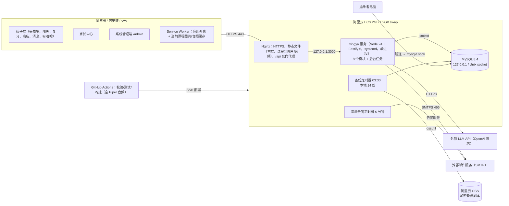
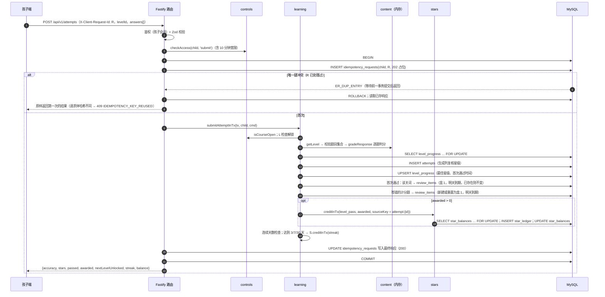
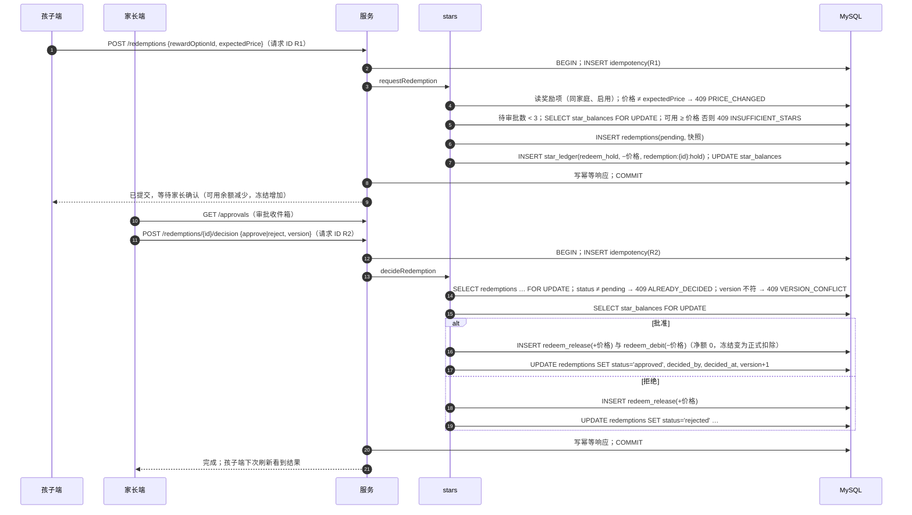

# 星芽学园 · 全新系统设计规格（Greenfield）

| 项目 | 内容 |
| --- | --- |
| 文档 | 星芽学园全新系统设计规格 |
| 版本 | 1.0（正式规格） |
| 日期 | 2026-10-21（UTC+8） |
| 状态 | 设计已由用户逐节确认；本文是据此写成的正式规格，作为唯一的实现计划输入 |
| 性质 | 全新系统，**不是**任何旧版本的升级。旧仓库 `leomoon2016/learning-platform` 只作功能参考，旧代码与旧数据全部丢弃 |
| 被替代 | `/workspace/lp-redesign` v2.1.1 全部文档作废，本文不沿用其结构 |
| 配套 | `schema-draft.sql`（MySQL 8.4 DDL 草案，36 张表，已在临时 MySQL 8.4.6 上验证，见附录 A） |

---

## 0. 术语

| 术语 | 含义 |
| --- | --- |
| 家庭 | 租户根。所有业务数据都带 `family_id`。一个家庭有多个家长和多个孩子 |
| 家长 | 家庭内的管理者，邮箱 + 密码登录；同一家庭的家长权限相同 |
| 孩子 | 家长添加的学习者档案，昵称 + 头像 + 年级 + 4 位 PIN，可选用户名/密码 |
| 系统管理员 | 运维账号，不属于任何家庭；只处理举报、异常与系统设置 |
| 家庭设备 | 家长登录后标记为“家庭设备”的浏览器；此后显示头像墙，孩子点头像输 PIN 进入 |
| 课程包 | 仓库 `content/` 目录经 CI 校验、构建（含 Piper 音频）后的只读内容版本 |
| 年级 > 课程 > 关卡 > 题目 | 内容层级。词有跨版本稳定 ID |
| 闯关记录（attempt） | 孩子完成一关后整批提交的一条服务端记录 |
| 复习条目 | 进入间隔复习队列的一个词或一道错题，处于 1–6 盒之一 |
| 星星流水 | 只追加的星星账本；余额由流水推导 |
| 本地日期 | 按家庭时区换算的日期；所有“每天”“每周”的规则都按本地日期计算 |
| 客户端请求 ID | 每个写请求携带的 UUID（请求头 `X-Client-Request-Id`），用于幂等 |
| 呀哈哈 | 新系统里的 AI 聊天助手（原创小树灵形象）。旧系统中同名的“收藏品”玩法不保留 |

---

## 1. 背景与目标

### 1.1 背景
旧系统是为一个家庭（3 个孩子）逐步长出来的：同步 SQLite 风格业务层经 worker 桥接 MySQL、内容以 JSON 大字段入库并靠启动补丁升级、十几种奖励货币、错题“答对即移除”、管理员与家长两套账号、MySQL 对公网开放、使用第三方 IP 形象（详见 `/workspace/greenfield-review/01-现状功能清单与问题.md`，下称“评审报告”）。本次决定**从零设计**：保留被验证有用的功能意图，用更小、更可靠的结构重新实现。

### 1.2 用户明确说的 vs 本规格的假设

| 类别 | 用户明确决定（已确认） | 本规格据此补充的假设/细化（见 §14.2 汇总） |
| --- | --- | --- |
| 用户范围 | 先自己家庭，后开放给更多家庭；家庭为租户；首发 1 个家庭；无计费、无机构 | 注册先用“邀请码模式”，由系统管理员发码；以后切到开放注册只改一个设置 |
| 客户端 | 首发只有 Web（React 19 + Vite，可安装 PWA）；小程序和苹果应用以后复用同一 API | 会话令牌同时支持 Cookie 与 `Authorization: Bearer`，为以后客户端预留，首发只用 Cookie |
| 内容 | 首发只有英语（单词、发音、课程关卡）；学科是字段 | 新学科只需新增内容和题型，数据库不改（`subject`/`type` 用受正则约束的 VARCHAR） |
| 架构 | 模块化单体：Node 24 + Fastify 5 + Kysely + Zod + mysql2；Nginx；MySQL 8.4 只监听本机，SSH 隧道管理；LLM 与邮件外部；Piper 构建期生成音频；1 台阿里云 ECS 2GB + swap；每晚备份 14 天 + OSS | 内容目录放在同一个 Git 仓库（`content/`），同一条 CI 流水线；应用与 SSH 隧道都经 Unix socket 连接 MySQL |
| 学习 | 4 种题型、每关 5–8 题、≥80% 通过、1–3 星、只发提升差额；整批提交；间隔 1/2/4/7/15/30 天；每日最多 20 条 | 跟读题不计分；星级阈值 100%/90%/80%；复习完成奖励 2 星；连续里程碑 3/7/20 星 |
| 星星与社交 | 只追加流水；商店、原创宠物；现实奖励冻结/批准；赠送每天 ≤20；周排行只算学习所得；跨家庭需双方家长确认 | 好友关系以“家庭”为单位，用好友码发起；全站榜只含开启跨家庭功能的家庭 |
| 账号 | 家庭为根；家长邮箱密码；孩子 PIN；家庭设备；PIN 5 次错锁 15 分钟；远程下线 | 管理员登录必须 TOTP；会话时长见 §4.3.5 |
| 管控与报告 | 每日时长、可用时段、30 秒心跳、服务端强制、+15 分钟；夜间汇总；周日 20:00 周报；审批收件箱；呀哈哈 20 条/天 | 默认 40 分钟/天、07:00–21:00；超时后已开始的作答有 10 分钟提交宽限 |
| 工程 | 客户端请求 ID 幂等；一个业务操作一个事务；账本靠 DB 授权只追加；设置乐观锁；离线只缓存外壳与当前课程音频；测试、部署、13 周排期；ICP 备案是上线阻塞项 | 幂等表只记成功结果；锁顺序约定见 §4.5.2 |

### 1.3 目标
1. 一个家庭的孩子能在家庭平板/电脑上每天自主完成“闯关 + 复习”，家长能设定时长、看到报告、审批奖励。
2. 学习以**掌握**为中心：间隔复习替代“答对即移除”；星星只奖励掌握与坚持，不奖励被动点击。
3. 正确性可证明：星星账本只追加、余额可对账、所有写操作幂等、并发编辑可检测。
4. 运维足够小：1 台 2 GB 服务器、1 个服务进程、无公网数据库、无在线语音服务；一个人可以维护。
5. 为“开放给更多家庭”预留安全边界：家庭租户隔离、跨家庭功能默认关闭、儿童安全约束内建。

### 1.4 成功标准（上线验收）
| # | 标准 | 衡量方式 |
| --- | --- | --- |
| S1 | 关键流程可用 | Playwright 端到端用例全部通过：PIN 登录、通关、复习、购买、兑换、赠送、时长锁定（§10.4） |
| S2 | 首发内容可学 | 迁移后的英语课程包通过校验器（§7.4），所有题目有图/音资源 |
| S3 | 账本正确 | 并发与重放集成测试通过；上线后每晚对账差异为 0（§4.5.3） |
| S4 | 性能 | 生产 ECS 上 10 个并发用户，非 AI 接口 p95 < 300 ms；首屏初始 JS ≤ 200 KB（gzip）；已缓存课程的关卡打开 < 1 s |
| S5 | 可恢复 | 上线前用 OSS 上的备份完成一次恢复演练；RPO ≤ 24 小时，RTO ≤ 2 小时 |
| S6 | 家庭试用 | 上线后 2 周内，家庭的孩子每周至少 5 天使用，且没有“提交丢失/星星不对”的问题报告 |
| S7 | 儿童安全 | 跨家庭自由文本、链接、图片在接口与数据库两层都不可能写入（测试覆盖）；AI 过滤用例集全部通过 |

### 1.5 非目标（明确不做，YAGNI）
- 计费、订阅、支付、机构/学校/班级、多组织。
- 微信小程序、苹果应用（以后做，复用同一 API）；首发也不做安卓原生。
- 离线答题队列（离线时提交失败即提示重试，不排队）。
- 自动发音评分、录音上传、第三方口语评测。
- 后台在线编辑课程（内容只走仓库 + CI）；课程资料上传、扫码上传。
- 在线语音合成服务、角色变声、语音参数后台。
- 数学、语文内容（字段预留，首发不做）。
- 四层授权表（年级/学科/课程/单元授权）；只有一条“课程开放”规则。
- 数据库远程访问（公网或白名单直连）、远程数据库账号。
- 多币种（积分、碎片、月亮/太阳）、隐藏奖励、秘密路线、概率掉落、宠物喂食/饥饿/等级/营位。
- 个人单词本、AI 生成释义、单词考试；AI 随学辅导；学生自带模型。
- 推送通知（APNs/订阅消息）；邮件之外的通知渠道。
- 自适应难度、知识图谱、诊断小测、亲子合作任务（以后可基于现有数据加）。
- 多实例部署、读写分离、缓存集群、消息队列。
- 第三方 IP 形象（任天堂等）——全部原创。

---

## 2. 与旧系统的取舍

依据评审报告 §2–§4。“保留”= 功能意图保留（实现全部重写）；“重设计”= 意图保留但规则/结构改变；“放弃”= 新系统不做。

| 旧功能（评审报告出处） | 取舍 | 新做法 / 理由 |
| --- | --- | --- |
| 登录时选身份，三枚 Cookie，同浏览器多身份（§2.1、F10） | 重设计 | 一枚会话 Cookie，一个浏览器同一时刻一个身份；家长与孩子分属同一家庭；低龄孩子用头像 + PIN |
| 登录限流（IP + 账号，1 分钟 10 次） | 保留（重设计） | 家长：按邮箱 10 次失败锁 15 分钟 + IP 限流；孩子：PIN/密码 5 次错锁 15 分钟（锁状态落库，重启不丢） |
| 空库自动建 `admin/admin` 与演示学生（§2.1） | 放弃 | 安全风险。系统管理员由运维命令创建，强制 TOTP；家庭由注册产生 |
| 管理员（实为家长）与“家长角色”两套账号（F10、I4） | 重设计 | 家长即家庭管理者；系统管理员是独立运维账号，不在任何家庭 |
| 管理员手工创建家长并指派孩子（§2.3） | 重设计 | 家长自助注册（邀请码模式）建家庭，可邀请其他家长，权限相同 |
| 无路由、单页状态切换（§2.1、F13） | 重设计 | React Router 深链接；服务端 Fastify 路由 + Zod 校验，按模块分文件 |
| 年级/学科/课程三层授权（F17、I6） | 重设计 | 一条规则：默认开放孩子当前年级全部英语课程；家长可额外开放或关闭具体课程 |
| 单元冒险地图、雾化预览、大陆总览（§2.2） | 重设计 | 首发为“课程关卡路线图”（顺序解锁、星数）；旧美术可作为课程封面/背景素材复用 |
| 开始任务冻结题目快照，start/answer/finish 三步（§2.2） | 重设计 | 关卡题目来自只读课程包，词/题有稳定 ID；完成后整批提交一次，服务端重新判分 |
| 9 种关卡类型 + cloze（§2.2） | 重设计 | 首发 4 种：看图选词、听音选词、拼写、跟读。对话/故事排序/阅读类不迁移 |
| 一、二年级禁用拼写/阅读 | 保留（重设计） | 变成课程包校验规则：1–2 年级课程不得含拼写题 |
| 答对 600ms 自动下一题、答错停留看解释 | 保留 | 客户端交互；答案随题下发用于即时反馈，提交时服务端以自己的判分为准 |
| 计分 100%=3、≥80%=2、≥60%=1，补差发星 | 重设计 | ≥80% 才通过；100%=3、≥90%=2、≥80%=1；重玩只在星级提高时补差额 |
| 错题本答对一次即移除；日常复习发积分（F9、I2） | 重设计 | 统一间隔复习队列：词与错题进入 1–6 盒（1/2/4/7/15/30 天），对则升盒、错回 1 盒，每日 ≤20 条 |
| 六年级全英文用日期字符串特判（F3） | 放弃 | 改为课程属性 `instructionLang` |
| 服务端 Piper 实时合成、语音服务、两级缓存、预热、取消队列（F16、I10） | 重设计 | 构建期一次性生成（按内容哈希命名），Nginx 静态服务；可用真人录音覆盖 |
| 语文拼音录音白名单（§2.2） | 放弃 | 首发只有英语 |
| 角色问候变声（FFmpeg） | 放弃 | 静态内容不需要；减少运行时依赖 |
| 无录音、无口语评测 | 新增（有限） | 跟读：录音只存在浏览器内存，与标准音对比回放，不上传、不评分 |
| 多币种：积分、碎片、单词星、月亮/太阳、隐藏奖励、秘密路线入场费、宠物附赠（F8、I1） | 放弃 | 只保留星星；来源仅 5 种（§4.1.8）；被动行为（点喇叭、看卡片）不发星 |
| 星星小铺四卡：现实奖励、徽章、累计奖励、复习积分（§2.2） | 重设计 | 商店（装扮、宠物，内容包定义价格）+ 家长定义的现实奖励（冻结 → 批准扣除/拒绝释放） |
| 账本只追加（触发器）、余额不为负、requestId 幂等 | 保留（重设计） | 只追加改由数据库授权保证（应用账号无 UPDATE/DELETE）；所有写请求统一幂等 |
| 24 种宠物（含马里奥、林克、Rosalina）、营位、1–100 级、亲密度喂食、改名、退订返还、赠送宠物（F12、I8） | 重设计 | 原创宠物可收藏，选一只陪伴头像；无喂食/饥饿/等级/营位/退订/转赠 |
| 游戏搭档（马里奥金币、林克宝箱等） | 放弃 | 第三方 IP 风险 |
| 呀哈哈收藏品 30 款、概率投放活动（Y9、I9） | 放弃 | 概率与运营后台对家庭规模无意义；“呀哈哈”名字与形象改给 AI 聊天助手 |
| 星星伙伴、余额榜与学习榜、赠星 1–1000、学生站内信（F11、I7） | 重设计 | 周榜只算学习所得；赠送每人每天 ≤20；跨家庭只能预设短语与表情、需双方家长确认好友；可举报/屏蔽；家长可看全部消息 |
| 个人单词本、AI 生成释义、单词闯关/考试/单词星（§2.2） | 放弃 | 首发以课程词的间隔复习代替；儿童场景不使用未经审核的 AI 生成学习内容 |
| 左下角浮动 AI 聊天（学生、管理员），多模型、自带模型（F14、I12） | 重设计 | 呀哈哈：所有页面的浮动聊天（孩子与家长）；对话只在浏览器内存；输入输出过滤；每日配额；单一服务端模型配置 + 全站开关；不允许自带模型 |
| AI 随学辅导（入口已关，代码仍在） | 放弃 | 死代码与额外攻击面 |
| 个人设置：年级、昵称、示范声音开关、减少动画、星星鼠标拖尾 | 部分保留 | 年级/昵称/头像由家长设；“自动播放发音”“减少动画”保存在设备本地；鼠标拖尾放弃 |
| 家长：学习情况、星星流水、加减星、核销奖励、改孩子密码（§2.3） | 重设计 | 家长中心：每日报告、周报邮件、审批收件箱、手动奖励（只加不减）、管控设置、设备与会话管理 |
| 无学习时长、无周报（§2.3、G2、G3） | 新增 | 30 秒心跳计时、服务端强制、每晚汇总、周日 20:00 周报邮件 |
| 管理员：学习全览、知识图谱（§2.4） | 放弃 | 由家长报告替代；系统管理员不浏览家庭学习数据 |
| 管理员：教材与关卡原始 JSON 编辑（W1、F2、I13） | 放弃 | 内容即代码：仓库 + 校验器 + CI；线上无编辑 |
| 管理员：课程资料上传、72 小时匿名扫码上传、ZIP 导出（I11） | 放弃 | 来源素材放内容目录 |
| 管理员：宠物/呀哈哈/徽章管理、语音设置、AI 模型配置 ≤20 个 | 放弃 / 重设计 | 物品与价格在内容包；AI 只保留“模型名 + 全站开关” |
| 内容 JSON 大字段 + 启动补丁 + 升级脚本（F2、F4） | 重设计 | 部署时由导入器把课程包写入只读内容表；稳定 ID，删除即“退役”，从不硬删 |
| 同步 SQLite 风格业务层 + SharedArrayBuffer 桥接 MySQL + 方言翻译（F1） | 放弃 | 原生异步 Kysely + mysql2；一种 SQL 方言 |
| 空更新当锁、运行时探测表结构、表名后缀版本（F5–F7） | 放弃 | 显式 `SELECT … FOR UPDATE` 锁行；版本化 SQL 迁移文件，部署时自动应用 |
| MySQL 公网 3306 + TLS（W4、Y2） | 放弃 | 只监听本机；管理经 SSH 隧道；无远程账号 |
| 数据库快照（含密码哈希）提交进 Git（W5、F15） | 放弃 | 备份只在服务器与 OSS（加密）；仓库禁止数据文件 |
| 2 GB 无 swap 导致 MySQL OOM、磁盘 97%（W3） | 重设计 | 内存/磁盘预算 + 2 GB swap + 资源告警邮件（§9.3） |
| 前端主包 > 500 KB（P14） | 重设计 | 孩子端、家长端、管理端按路由拆包，初始 JS 预算 200 KB |
| 屏幕阅读器、文字缩放等未验收（P13、G6） | 新增 | 无障碍基线写入验收（§8.3） |

---

## 3. 总体架构

### 3.1 部署拓扑



### 3.2 技术栈
| 层 | 选型 | 说明 |
| --- | --- | --- |
| 前端 | React 19、Vite、React Router、TanStack Query、vite-plugin-pwa（Workbox）、CSS Modules | 孩子端/家长端/管理端三个懒加载路由块 |
| 服务端 | Node 24 LTS、TypeScript（strict）、Fastify 5、Zod（请求/响应/课程包共用）、Kysely、mysql2、pino、nodemailer | 单进程；时间统一通过可注入的 `Clock` 获取（测试可控） |
| 数据库 | MySQL 8.4 LTS、InnoDB、utf8mb4、REPEATABLE READ | 连接 `time_zone='+00:00'`；所有 DATETIME 存 UTC |
| 内容工具 | Zod 校验器、构建器、导入器、Piper（离线）、ffmpeg（编码 MP3） | 只在 CI 与部署时运行 |
| 测试 | Vitest（单元/集成）、Playwright（端到端） | 集成测试用 CI 中真实 MySQL 8.4 |
| 运维 | Nginx、systemd、GitHub Actions、ossutil、age（备份加密） | 无容器编排 |

### 3.3 仓库结构（单仓库）
```
xingya/
  apps/web/                 React 19 + Vite PWA（child/、parent/、admin/ 三个路由块）
  apps/server/
    src/modules/<module>/   identity | content | learning | stars | social | yahaha | controls | reports
      index.ts              模块公开接口（唯一允许被其他模块 import 的文件）
      routes.ts             HTTP 路由（Zod 模式）
      service.ts            业务规则
      repo.ts               本模块表的 Kysely 查询（只碰自己的表）
    src/platform/           db、事务与幂等、错误、鉴权钩子、Clock、调度器、邮件发送、配置
  packages/shared/          API 与课程包的 Zod 模式、错误码、规则常量
  packages/content-tools/   validate / build / import / gen-audio / legacy-convert
  content/                  课程包源（§7）
  db/migrations/            V001__init.sql …（版本化、只前进）
  deploy/                   nginx.conf、systemd 单元、bootstrap/backup/alert 脚本
  e2e/                      Playwright 用例
  docs/
```

### 3.4 模块与边界规则
八个模块，各自拥有自己的表，只通过 `index.ts` 暴露函数：

| 模块 | 代码名 | 拥有的表 |
| --- | --- | --- |
| 家庭账号 | identity | families, parents, children, admin_accounts, family_devices, sessions, auth_tokens, audit_events |
| 课程内容 | content | courses, levels, words, questions, shop_items（应用只读）+ 内存中的 avatars/phrases/emoji/安全词表 |
| 学习 | learning | level_progress, attempts, review_items, review_sessions |
| 星星 | stars | star_ledger, star_balances, child_items, reward_options, redemptions |
| 社交 | social | family_friendships, gifts, messages, blocks, abuse_reports |
| AI 聊天（呀哈哈） | yahaha | ai_chat_usage |
| 家长管控 | controls | child_controls, course_overrides, usage_days |
| 报告通知 | reports | daily_reports, email_outbox |
| 平台（非业务模块） | platform | system_settings, idempotency_requests, schema_migrations |

边界规则（CI 强制）：
1. 模块之间只能 import 对方的 `index.ts`（dependency-cruiser 规则）。
2. `repo.ts` 只能引用本模块的表（一个测试扫描 Kysely 表名与上表比对）。
3. 跨模块写入在**同一事务**内完成：发起业务操作的模块开启事务，把 `tx` 传给其他模块以 `…InTx` 结尾的函数；被调用方从不自行提交。
4. 模块依赖无环（A → B 表示 A 调用 B）：learning → controls、stars、content；controls → content，并只读调用 stars 与 social（审批收件箱）；social → stars；stars → content（商店物品）；yahaha → controls；reports → 各模块的只读查询函数；所有模块 → identity（读取家庭、孩子）；identity 与 content 不依赖其他业务模块。

### 3.5 模块接口（关键函数）
以 TypeScript 签名表示（省略 `Promise<>`；`P` = 已鉴权主体 Principal；`Tx` = Kysely 事务）。

**identity**

```ts
registerFamily(cmd: {signupCode, email, password, displayName, familyName, timeZone}): {family, parent, session}
loginParent(email, password, ctx): Session            // 失败计数、锁定
inviteParent(p, email): void                          // 发 invite_parent 令牌邮件
acceptInvitation(token, password, displayName): Session
requestPasswordReset(email): void / resetPassword(token, newPassword): void / verifyEmail(token): void
createChild(p, {nickname, avatarKey, grade, pin}): Child
updateChild(p, childId, patch & {version}): Child      // 版本冲突 → VERSION_CONFLICT
setChildPin(p, childId, pin) / setChildCredentials(p, childId, {username, password} | null)
archiveChild(p, childId)
markFamilyDevice(p, label): {deviceToken}             // 设置 xy_device Cookie
listDeviceChildren(deviceToken): ChildCard[]          // 头像墙
loginChildByPin(deviceToken, childId, pin): Session
loginChildByPassword(username, password): Session
authenticate(sessionToken): P | null                  // 每个请求的鉴权钩子调用
listChildSessions(p, childId) / revokeSession(p, sessionId) / revokeFamilyDevice(p, deviceId)
getFamily(familyId) / getChild(familyId, childId) / listChildren(familyId)
updateFamily(p, {name?, timeZone?, version}) / setCrossFamily(p, enabled, version) / rotateFriendCode(p)
findFamilyByFriendCode(code): FamilyRef | null
recordAudit(tx, event)
```
**content**（启动时把当前课程包载入内存，只读）

```ts
packVersion(): string
listCourses(filter: {subject?, grade?}): Course[]
getCourse(courseId) / getLevel(levelId): LevelWithQuestions / getQuestion(id) / getWord(id)
levelWords(levelId): WordId[]                        // 该关计分题与跟读题涉及的全部词
nextLevel(levelId): LevelId | null / previousLevel(levelId): LevelId | null   // 跳过已退役关卡
pickDistractors(wordId, n): WordId[]                 // 同课程优先，确定性随机（种子 = 复习条目 ID）
gradeResponse(question, response): boolean           // 题型判分器注册表
listShopItems() / getShopItem(id)
avatars() / phrases() / emojis() / safetyLists()
```
**learning**

```ts
getCourseMap(child, courseId): LevelState[]           // locked | open | passed(stars)
getLevelForPlay(child, levelId): PlayableLevel        // 检查开放、解锁、时长
submitAttempt(child, cmd: {levelId, clientStartedAt?, answers[]}): AttemptResult
getReviewSummary(child): {dueToday, doneToday, remainingToday, completedToday}
getReviewBatch(child): ReviewQuestion[]               // ≤ 20 - doneToday
submitReview(child, cmd: {items[]}): ReviewResult
getStreak(child): {current, longest, todayCounts}
statsForDay(familyId, childId, date): LearningDayStats  // 供 reports 聚合
```
**stars**

```ts
getBalance(childId): {available, held}
listLedger(familyId, childId, cursor)
creditInTx(tx, {familyId, childId, kind, delta, sourceKey, localDate, actorParentId?, note?}): LedgerEntry
debitInTx(tx, …同上): LedgerEntry                     // 余额不足 → INSUFFICIENT_STARS
parentAward(p, childId, {amount, note})
purchase(child, {itemId, expectedPrice}) / setEquipment(child, {slot, itemId | null}) / listOwned(childId)
listRewardOptions(familyId) / createRewardOption(p, …) / updateRewardOption(p, id, patch & {version})
requestRedemption(child, {rewardOptionId, expectedPrice}) / cancelRedemption(child, id)
decideRedemption(p, id, {decision: 'approve' | 'reject', note?, version})
listPendingRedemptions(familyId)
verifyBalances(): Mismatch[]                          // 夜间对账
```
**social**

```ts
getLeaderboard(viewer, scope: 'family' | 'friends' | 'all', isoWeek): Board
sendGift(child, {toChildId, amount})                  // 内部调用 stars.debitInTx/creditInTx
listContacts(child) / listConversation(viewer, withPrincipal, cursor)
sendMessage(sender, {to, kind, body? | phraseKey? | emojiKey?}) / markRead(viewer, messageId)
reportMessage(reporter, messageId, {reason, note?}) / block(actor, childId) / unblock(p, blockId)
requestFriendship(p, friendCode) / decideFriendship(p, id, decision, version) / endFriendship(p, id)
listIncomingFriendRequests(familyId) / listChildMessagesForParent(p, childId, cursor)
adminListReports(status) / adminResolveReport(admin, id, action, note)
```
**yahaha**

```ts
status(principal): {enabled, remainingToday}
chat(principal, {clientRequestId, messages[]}): {reply, filtered, remainingToday}
usageForDay(familyId, childId, date): {messages, filterHits}
purgeOldUsage(now)                                    // 90 天
```
**controls**

```ts
getControls(p, childId) / updateControls(p, childId, patch & {version})
setCourseOverride(p, childId, courseId, mode | null, version)
isCourseOpen(child, courseId): boolean / listOpenCourses(child): CourseId[]
heartbeat(child): TimeStatus                           // 计时 + 返回是否锁定
checkAccess(child, activity: 'start' | 'submit' | 'chat'): void   // 超限抛 TIME_LIMIT_REACHED / OUTSIDE_ALLOWED_HOURS
grantExtraTime(p, childId): TimeStatus                 // +15 分钟
getApprovalsInbox(p): {redemptions, friendRequests}   // 汇总 stars 与 social
usageForDay(familyId, childId, date): {seconds}
```
**reports**

```ts
getDailyReports(p, childId, from, to) / getTodayLive(p, childId) / getWeekly(p, childId, isoWeek)
runNightlyAggregation(now)                             // 每 15 分钟调度，按家庭时区处理“昨天”
enqueueWeeklyReports(now)                              // 每 5 分钟调度，周日 20:00 后入队
enqueueEmail(tx | db, {kind, dedupeKey, to, subject, html, text, familyId?, parentId?})
sendDueEmails(now)                                     // 每 30 秒
unsubscribe(signedToken)
```

### 3.6 后台任务（进程内调度器，单实例）
| 任务 | 周期 | 内容 |
| --- | --- | --- |
| 夜间汇总 | 每 15 分钟检查 | 对本地时间已过 00:30 且“昨天”尚未汇总的家庭生成 `daily_reports`（幂等 UPSERT） |
| 周报入队 | 每 5 分钟检查 | 对本地时间为周日 20:00–23:59 的家庭，为每个已验证邮箱且订阅的家长入队，去重键 `weekly:{parentId}:{ISO周}` |
| 邮件发送 | 每 30 秒 | 发送到期邮件；退避 1m/5m/30m/2h/6h…，最多 10 次后 `failed` 并告警 |
| 账本对账 | 每天 04:00（UTC+8） | 每个孩子 `SUM(delta)` = `star_balances.balance` = 最后一行 `balance_after`；不一致写审计并发管理员告警 |
| 数据清理 | 每天 04:30（UTC+8） | AI 元数据 > 90 天、幂等记录 > 30 天、过期会话/令牌、已发送邮件正文（发送后即清空，此处兜底）、发送完成 > 180 天的邮件行 |

调度器在任务执行时用 MySQL `GET_LOCK('xingya:job:<name>', 0)` 防止重叠执行（例如部署切换瞬间两个进程并存）。

---

## 4. 功能设计

### 4.1 学习（第 2 节）

#### 4.1.1 内容结构
- 层级：年级（1–6）> 课程（属于一个学科、一个年级）> 关卡（课程内有序）> 题目（每关 5–8 道）。
- 每个词有稳定 ID（如 `en.apple`、同形异义用后缀 `en.bat-animal`）。ID 一经发布永不改义、永不复用；内容修订通过“退役 + 新 ID”或允许的拼写勘误（§7.4 规则 C6）完成。课程、关卡、题目同样使用稳定 ID。
- 内容表对应用只读；课程包删除的条目在导入时标记 `retired=1`，历史记录仍可关联。

#### 4.1.2 课程开放与关卡解锁
- 课程开放规则（唯一规则，由 controls 判断）：
  `open(child, course) = course.retired = 0 AND ( override = 'open' OR (override 不存在 AND course.grade = child.grade) )`，
  其中 `override` 是 `course_overrides` 中该孩子该课程的记录；`closed` 即关闭。
- 关卡解锁：课程内第一个未退役关卡总是解锁；之后每一关在“前一个未退役关卡已通过”或“本关已有通过记录”时解锁。中途插入的新关卡不会把已通过的后续关卡重新锁上。
- 孩子年级改变后，旧年级课程不再默认开放，但已有进度保留；家长可用 `open` 覆盖重新开放。

#### 4.1.3 题型（英语首发 4 种）
| 类型 | 代码 | 呈现 | 作答 | 计分 |
| --- | --- | --- | --- | --- |
| 看图选词 | `pick_image` | 图片 | 从 3–4 个词选项中选一个 | 是 |
| 听音选词 | `listen_choose` | 播放标准音（可重复） | 从 3–4 个词选项中选一个 | 是 |
| 拼写 | `spell` | 图片 + 中文提示 + 可播放发音 | 键入或点选字母拼出单词 | 是：去首尾空格、大小写不敏感、`’`/`'` 视为同一字符，与 `answer` 或 `accept[]` 之一完全相同 |
| 跟读 | `read_aloud` | 播放标准音（词或短句） | 录音 → 依次回放“标准音 / 我的录音”自我对比 | **否**：无自动评分；不计入正确率；录音只在浏览器内存，离开题目即丢弃，从不上传 |

- 麦克风不可用或孩子拒绝授权时，跟读题显示“听一听再大声读”并可直接继续；记录 `{done:false}`，不影响通过。
- 选项展示顺序在客户端随机；判分只看所选词 ID。

#### 4.1.4 判分、通过与星级
- 计分题数 `S`（4–8，校验器保证每关至少 4 道计分题）、答对数 `C`；正确率 `accuracy = floor(C×100/S)`。
- 通过：`C×100 ≥ S×80`。星级：`C = S` → 3 星；`C×100 ≥ S×90` → 2 星；通过 → 1 星；未通过 → 0。
  （例：5 题对 4 题 = 80% → 1 星；8 题对 7 题 = 87% → 1 星；4 题对 3 题 = 75% → 未通过。）
- 发星：`awarded = max(0, 本次星级 − 该关历史最佳星级)`，1 个星级 = 1 颗星。首次 3 星一次拿 3 颗；之后从 1 星提到 3 星补 2 颗；重玩不提高不发。
- 数据库用生成列再算一遍（`attempts.accuracy_pct/stars/passed`），与代码规则不一致时插入失败，保证两处一致。

#### 4.1.5 闯关提交（整批、一次记录、重复只算一次）
- 孩子打开关卡：`GET /levels/:id` 返回题目（含答案用于即时反馈）与资源 URL；服务端检查课程开放、关卡解锁、`checkAccess('start')`。
- 孩子在本地依次作答，全部完成后一次性 `POST /attempts`，请求头带客户端请求 ID。客户端在内存中保留答案，网络失败时提示“重试”，重试使用**同一个**请求 ID。
- 服务端要求提交的题目集合恰好等于该关当前未退役的题目集合（每题一次），否则 `409 CONTENT_STALE`（客户端重新加载关卡）。
- 同一请求 ID 的重复提交返回第一次的结果，不会产生第二条记录或第二次发星（幂等表 + `attempts(child_id, client_request_id)` 唯一键双保险）。不同请求 ID 的两次提交是两次真实闯关，各自计算。
- 不需要“开始”接口，也没有“过期响应代次”逻辑。



#### 4.1.6 间隔复习
- 复习条目两类：**词**（首次通过某关时，该关全部词进入）和**错题**（任何一次闯关中答错的计分题进入；跟读题从不进入）。同一孩子同一词/题只有一条（唯一键）。
- 盒与间隔：盒 1–6 对应 1、2、4、7、15、30 天。新条目进入盒 1，到期日 = 本地今天 + 1。
- 复习作答：答对 → 盒 +1（最高 6，在 6 盒答对仍为 6），到期日 = 今天 + 新盒间隔；答错 → 回到盒 1，到期日 = 今天 + 1，`lapses + 1`。已存在的错题条目在闯关中再次答错同样重置为盒 1。
- 复习入口显示“今日到期数”= `due_date ≤ 今天` 的条目数。每天最多复习 20 条：`GET /review/batch` 返回 `min(到期数, 20 − 今日已复习数)` 条，按 `due_date`、`box`、`id` 升序；超出部分仍保持到期，自然顺延到第二天。
- 词条目的题目由服务端现场生成：有图的词出“看图选词”，否则出“听音选词”；干扰项由 `pickDistractors` 以条目 ID 为种子确定性选出，因此无需保存生成的题目，提交时只需比较所选词 ID。错题条目重放原题。
- 提交 `POST /review/sessions`（整批、幂等）。服务端只对“此刻仍到期且属于该孩子”的条目判分（另一台设备已复习过的条目忽略），一批最多 20 条且不超过当日剩余额度。
- **今日复习完成**：某次提交后满足 `今日已复习数 ≥ 20` 或 `剩余到期数 = 0`，且当天开始时有到期条目，则这批记录 `completes_day = 1`（数据库唯一键保证每天最多一次）并发 2 颗星。当天没有到期条目不算完成、不发星。
- 中途退出复习不提交，不留记录。

#### 4.1.7 连续学习天数
- “学习日”= 本地日期内**通过至少一关**（任何一次 `passed=1` 的闯关，含重玩）**或完成当日复习**。
- 当前连续天数 = 截至今天（或昨天，若今天尚未学习）的连续学习日数。
- 里程碑：连续段长度达到 3、7、30 天时各发一次：3 天 +3 星、7 天 +7 星、30 天 +20 星；`source_key = streak:{milestone}:{连续段起始日期}`，同一连续段每个里程碑只发一次；断开后重新开始的连续段可再次获得。30 天之后不再有新里程碑。
- 不惩罚断签，不设补签。

#### 4.1.8 星星来源（仅此 5 种）
| 来源 | 流水 kind | 数量 | 计入排行榜 |
| --- | --- | --- | --- |
| 首次通过或星级提高 | `level_pass` | 1–3（差额） | 是 |
| 完成当日复习 | `review_day` | 2 | 是 |
| 连续天数里程碑 | `streak` | 3 / 7 / 20 | 是 |
| 家长手动奖励 | `parent_award` | 1–50 / 次，只能加 | 否 |
| 收到赠送 | `gift_in` | 1–20 | 否 |

点喇叭、看卡片、登录、聊天等被动行为一律不发星。支出类：`purchase`、`gift_out`、`redeem_hold`（冻结）、`redeem_release`（释放）、`redeem_debit`（批准扣除）。

### 4.2 星星、商店、宠物、现实奖励与社交（第 3 节）

#### 4.2.1 账本与余额
- `star_ledger` 只追加：每行 `delta`（正负号由 kind 决定，CHECK 约束）、`balance_after ≥ 0`、`source_key`（同一孩子唯一，业务级幂等）、`local_date`。
- **可用余额 = 该孩子全部流水 `SUM(delta)`**。`star_balances` 是同一事务内维护的缓存，同时充当该孩子的行锁；每晚对账（§3.6）。没有任何“直接改余额”的接口或 SQL。
- “冻结中”= 该孩子待审批兑换的价格之和（`redemptions.status='pending'`）。孩子界面显示“可用 N 颗，冻结 M 颗”。

#### 4.2.2 商店、装扮与宠物
- 物品（装扮：`head`/`body`/`accessory` 三个槽位；宠物：`pet` 槽）在课程包 `economy/shop.json` 定义：ID、名称、价格、图片、`artSource`（必须为原创或已授权，校验器拒绝第三方 IP 关键词）。
- 购买 `POST /shop/purchases {itemId, expectedPrice}`：服务端读取**当前**价格；与 `expectedPrice` 不同 → `409 PRICE_CHANGED`（返回新价格，孩子确认后重试）；已退役 → `404`；已拥有 → `409 ALREADY_OWNED`；余额不足 → `409 INSUFFICIENT_STARS`。成功则同一事务写 `purchase` 流水（`source_key = purchase:{itemId}`）与 `child_items`。
- 每件物品每个孩子只能买一次；无退货、无转赠。退役物品不再出售，已拥有的仍可穿戴。
- 穿戴：`PUT /me/equipment {slot, itemId | null}`；每个槽位最多一件（唯一键）。宠物可收藏多只，`pet` 槽中的一只陪伴头像显示。无喂食、饥饿、等级、亲密度。

#### 4.2.3 现实奖励兑换
- 家长维护本家庭的奖励清单（标题 ≤40 字、星价 1–2000、启用/停用，乐观锁）。
- 孩子申请 → 冻结；家长批准 → 扣除；拒绝 → 释放；孩子可撤回待审批申请 → 释放。每个孩子最多 3 个待审批申请。
- 申请时同样做价格复核（`expectedPrice`）；申请单保存标题与价格快照，之后家长改价不影响已申请的单。



#### 4.2.4 赠送星星
- 孩子之间赠送，单笔 1–20 颗，**每个孩子每个本地日期累计送出 ≤ 20 颗**（按发送方家庭时区）。
- 家庭内（兄弟姐妹）可直接赠送；跨家庭要求：两个家庭都开启跨家庭功能、两家庭之间存在 `active` 好友关系、双方之间没有屏蔽。
- 事务：按 `child_id` 升序锁定双方 `star_balances` → 在发送方锁内统计当天已送总额 → 写 `gifts`、`gift_out`（发送方）与 `gift_in`（接收方）流水。
- 收到的赠送可以消费，但不计入排行榜。

#### 4.2.5 周排行榜
- 统计口径：本周（周一至周日，按各孩子家庭的本地日期；周标签为 ISO 周 `YYYY-Www`）内 `counts_for_leaderboard = 1` 的流水（`level_pass`、`review_day`、`streak`）之和。赠送、家长奖励、消费、兑换都不影响。
- 范围：
  - **本家庭**：本家庭所有未退出排行的孩子。
  - **好友家庭**：本家庭 + 所有 `active` 好友家庭（双方都开启跨家庭功能）中未退出排行的孩子。
  - **全站**：所有开启跨家庭功能的家庭中未退出排行的孩子；只显示昵称与头像（不显示家庭名、年级）；显示前 50 名与自己的名次。只有本家庭开启跨家庭功能时才能看全站榜与好友榜。
- 家长可让孩子“退出排行榜”：该孩子不出现在任何榜单，且其界面不显示排行榜入口。
- 计算：读取时按周聚合，结果在进程内缓存 60 秒（规模下足够）。

#### 4.2.6 消息
- 家庭内：孩子 ↔ 孩子、孩子 ↔ 家长可发自由文本（≤200 字）、预设短语、表情。
- 跨家庭：只允许孩子 ↔ 孩子，且只能发预设短语或表情（课程包 `social/phrases.json`、`social/emoji.json` 白名单），**不能发自由文本、链接、图片**（接口校验 + 数据库 CHECK 双重保证）。前提同赠送：双方家庭开启跨家庭功能、`active` 好友、无屏蔽。
- 每个孩子每天最多发 50 条消息。
- 家长可以阅读自己孩子的全部消息（发出和收到，含跨家庭）。
- 任何消息都可被收件方孩子或其家长举报：消息立即对双方隐藏（`hidden_at`），双方家长仍可见并标注“已举报”；进入系统管理员处理队列。
- 屏蔽：孩子可屏蔽某个孩子，家长可以“整个家庭”名义屏蔽某个孩子；被屏蔽双方之间不能互发消息、互赠星星。孩子能添加屏蔽，只有家长能解除。
- 系统管理员处理举报：`dismiss`（恢复显示）、`hide_message`（保持隐藏）、`disable_cross_family`（关闭发送方家庭的跨家庭功能）、`suspend_family`（停用发送方家庭）。目标是 48 小时内处理。

#### 4.2.7 好友家庭
- 跨家庭功能总开关在家庭设置中，**新家庭默认关闭**；开启时生成 8 位好友码（可重置）。
- 家长 A 输入家庭 B 的好友码 → 创建 `pending` 好友请求（A 方家长确认即发起本身）→ 出现在 B 家家长的审批收件箱 → B 家任一家长批准即 `active`（双方家长确认完成）或拒绝。
- 任一方家长可随时解除（`ended`），立即停止跨家庭消息与赠送；关闭跨家庭总开关同样立即暂停所有跨家庭互动（好友关系保留，重新开启后恢复）。
- 好友码尝试每个家庭每天最多 10 次（防枚举）。孩子不能发起好友请求。

### 4.3 家庭与账号（第 4 节）

#### 4.3.1 家庭与角色
- 家庭是根。第一个家长注册时创建家庭（家庭名、时区，默认 `Asia/Shanghai`）。
- 注册模式（系统设置 `registration.mode`）：`invite`（首发：需要系统管理员签发的一次性注册码）、`open`、`closed`。
- 家长可通过邮箱邀请其他家长（7 天有效链接），受邀者设置密码后加入，与邀请者权限完全相同。一个邮箱只属于一个家庭。任一家长可停用另一家长，但不能停用最后一个有效家长。
- 系统管理员：独立账号，由运维命令行创建（用户名 + 强密码 + 必须 TOTP），不属于任何家庭，不能查看家庭学习数据或修改星星；只处理举报、查看异常、修改系统设置、签发注册码、停用家庭。

#### 4.3.2 家长账号
- 邮箱（统一小写）+ 密码（≥ 8 位，拒绝常见弱密码表）；scrypt 哈希。
- 注册后发送邮箱验证邮件；未验证也可使用，但不会收到周报。
- 找回密码：邮件链接（30 分钟有效，一次性）；重置后该家长其他会话全部失效。
- 连续 10 次登录失败锁定 15 分钟；另有按 IP 的限流（10 分钟 20 次）。

#### 4.3.3 孩子档案
- 家长添加：昵称（家庭内唯一，≤ 20 字，过滤敏感词，禁止 5 位以上连续数字）、头像（课程包原创头像库中选择，不支持上传照片）、年级（1–6）、4 位 PIN（拒绝 0000、1234 等弱 PIN 表）。
- 可选：用户名（全站唯一，小写字母开头 4–32 位）+ 密码（≥ 6 位），用于非家庭设备登录。
- 家长可修改昵称、头像、年级（乐观锁）、重置 PIN、设置/取消用户名密码、归档孩子（隐藏、会话失效、数据保留，可恢复）。

#### 4.3.4 登录方式
| 场景 | 流程 |
| --- | --- |
| 家庭设备 | 家长登录 → “将此设备设为家庭设备”并命名 → 服务器下发 `xy_device` Cookie（HttpOnly，365 天）→ 之后打开即为头像墙；孩子点头像输 PIN 进入；“换人”回到头像墙 |
| 家长在家庭设备上 | 头像墙右上“家长入口”→ 邮箱密码登录；15 分钟无操作自动退回头像墙 |
| 其他设备上的孩子 | 用户名 + 密码登录（需家长事先设置） |
| 家长个人设备 | 邮箱 + 密码 |
| 系统管理员 | `/admin`：用户名 + 密码 + TOTP |

- PIN 或孩子密码连续 5 次错误 → 该孩子锁定 15 分钟（`children.locked_until`），头像墙显示“请 15 分钟后再试或请家长帮忙”；家长可在家长中心立即解锁。
- 家长可查看每个孩子最近 30 天的登录设备（家庭设备名称或浏览器摘要、最近活动时间），可远程下线单个会话或撤销整台家庭设备（该设备上产生的孩子会话一并失效）。

#### 4.3.5 会话
| 主体 | 有效期 |
| --- | --- |
| 家长（个人设备） | 30 天滑动过期 |
| 家长（家庭设备上，会话记录 `family_device_id`） | 15 分钟无操作过期，最长 2 小时 |
| 孩子（PIN） | 最长 12 小时；切换孩子即注销 |
| 孩子（用户名密码） | 30 天滑动过期 |
| 系统管理员 | 30 分钟无操作过期，最长 8 小时 |

- 会话令牌为 32 字节随机数，库中只存 SHA-256；Cookie `xy_sid`：HttpOnly、Secure、SameSite=Lax、Path=/。同一浏览器同一时刻只有一个身份。
- `last_seen_at` 最多每 5 分钟更新一次。改密码、撤销设备、归档孩子、停用家长/家庭时相关会话立即失效。
- 以后的小程序/苹果应用使用同一会话表，经 `Authorization: Bearer` 传递令牌。

#### 4.3.6 课程开放（家长侧）
- 家长中心按年级列出全部英语课程，显示每门课对该孩子“默认开放/已额外开放/已关闭/未开放”，可切换为额外开放（任何年级）或关闭（本年级），或恢复默认。写操作带 `child_controls.version` 乐观锁。

### 4.4 家长管控、报告与呀哈哈（第 5 节）

#### 4.4.1 时长与时段
- 每个孩子：每日分钟上限（10–300，默认 40）、允许时段（默认 07:00–21:00，开始 < 结束，不跨午夜），按**家庭时区**判断。
- 计时：孩子端在页面可见（`visibilityState = visible`）且最近 2 分钟内有过操作或正在播放音频时，每 30 秒发送 `POST /heartbeat`。服务端在 `usage_days` 行锁内累加 `min(30, 距上次心跳秒数)`（当天首次为 30 秒），因此多设备同时使用按墙钟只算一次、重复心跳几乎不加时。处于锁定状态（时长用完或时段外）时心跳只返回状态、不累加。呀哈哈聊天发生在页面内，同样被计入。
- 服务端强制：
  - `start` 类请求（打开关卡、获取复习批次）、呀哈哈聊天：已用 ≥ `(上限 + 加时) × 60` 秒 → `403 TIME_LIMIT_REACHED`；时段外且未在临时延长期内 → `403 OUTSIDE_ALLOWED_HOURS`。
  - `submit` 类请求（闯关提交、复习提交）：锁定后 10 分钟内仍接受，避免已完成的作答丢失；超过宽限则拒绝。
  - 心跳响应携带状态，客户端据此显示友好的“休息一下”页面（显示可再次使用的时间），覆盖孩子端全部功能。商店、消息等其他孩子端接口服务端不额外拦截（它们不产生学习时长之外的风险），由休息页在界面上统一挡住。
- 家长“再玩 15 分钟”：`bonus_minutes += 15`（每天最多 120），并把 `window_extended_until` 设为 `max(现在, 原值) + 15 分钟`，即同时放宽时长与时段。
- 家庭时区可修改，从下一个本地日期起生效。

#### 4.4.2 报告
- 每晚为每个孩子汇总前一个本地日期（`daily_reports`）：使用时长、闯关次数、首次通过关卡数、计分题数与答对数（正确率）、复习条目数与是否完成当日复习、星星收入（正向流水，不含 `redeem_release`）与支出（`purchase`、`gift_out`、`redeem_debit`）、最常错的 5 个词（来自闯关答案与复习结果）、呀哈哈消息数与过滤命中数。
- 家长中心：今天（实时计算）+ 最近 30 天（读汇总表）的图表与列表。
- 周报邮件：每周日 20:00（家庭时区）发给已验证邮箱且订阅的家长，内容为本周一至当时每个孩子的上述指标合计、学习天数、连续天数、最常错词与一句基于规则的建议（如“apple 本周错了 3 次，明天复习会再出现”）。每封邮件含一键退订（`List-Unsubscribe` + `List-Unsubscribe-Post`，带签名令牌），家长中心也可重新订阅。

#### 4.4.3 审批收件箱
- 家长中心“待处理”：孩子的现实奖励兑换申请、其他家庭发来的好友请求。显示数量徽标；处理后从列表消失。

#### 4.4.4 呀哈哈（AI 聊天）
- 所有页面右下角浮动入口，孩子与家长都可用（管理端不提供）。
- 对话只存在于浏览器内存（React 状态，不写 localStorage），刷新、注销、换人即清空。每次请求带最近 ≤10 轮（≤20 条）上下文，单条用户输入 ≤ 200 字，总长 ≤ 4000 字。
- 服务端只存元数据（时间、主体、模型、状态、字符数、token 数、过滤命中类别、耗时），保留 90 天；不存任何对话文本。
- 流程：全站开关 → 孩子配额（`ai_daily_limit`，默认 20，0 = 关闭）/ 家长固定 100 条 → `checkAccess('chat')`（孩子）→ 在 `child_controls` 行锁内统计当日用量并插入 `pending` 记录（请求 ID 唯一，重放 → `409 CHAT_DUPLICATE_REQUEST`）→ 输入过滤 → 调用 LLM（超时 20 秒，最多 300 token）→ 输出过滤 → 更新记录 → 返回。
- 过滤：课程包 `safety/` 中维护的分类词表（色情、暴力、自伤、仇恨、政治、脏话）+ 规则（网址、电话号码、身份证号、QQ/微信号、具体住址模式）。输入命中：不调用 LLM，返回呀哈哈的友好引导语；自伤类命中返回“请马上告诉爸爸妈妈或信任的大人”；输出命中：替换为安全回复。命中都计入配额并在家长报告中按类别计数。配额统计当日状态为 `pending`、`ok`、`input_blocked`、`output_blocked` 的记录；`error`、`timeout` 不计入。
- 系统提示词（版本化存于仓库）要点：你是“呀哈哈”，一个友善的小树灵，对象是 6–12 岁孩子；用简短中文或简单英语回答，鼓励学英语；不询问也不记录姓名、学校、住址、电话等个人信息；不提供链接；拒绝不适合儿童的话题并建议问家长；不假装是真人；不给医疗/法律建议。发给 LLM 的内容不含昵称、家庭信息等身份数据。
- 模型名来自系统设置 `ai.model`，必须属于服务器配置中的允许列表；系统管理员可在后台切换。全站开关 `ai.enabled` 关闭后 10 秒内生效（设置缓存 10 秒），入口隐藏、请求返回 `503 AI_DISABLED`。

### 4.5 正确性与工程（第 6 节）

#### 4.5.1 幂等
- 所有需登录的写请求（POST/PUT/PATCH/DELETE）必须带 `X-Client-Request-Id`（小写 UUID v4），缺失 → `400 VALIDATION_FAILED`。客户端为每个用户动作生成一次，自动重试沿用同一个。
- 通用机制：事务第一步插入 `idempotency_requests(actor, requestId, operation, requestHash, 202 占位)`；业务完成后写入最终 2xx 响应并提交。并发的重复请求在唯一键上等待第一个事务结束，随后读取已存响应原样返回；同 ID 不同请求体 → `409 IDEMPOTENCY_KEY_REUSED`。业务错误（4xx）导致回滚，不占用该 ID。记录保留 30 天。
- 业务级二次保险：`attempts`/`review_sessions` 的 `(child_id, client_request_id)` 唯一键；`star_ledger(child_id, source_key)` 唯一键（如 `attempt:{id}`、`review:{date}`、`streak:{m}:{start}`、`purchase:{itemId}`、`gift:{id}:out`、`redemption:{id}:hold`）。
- 例外（不写幂等表，但天然幂等）：心跳（按时间差累加）、呀哈哈聊天（`ai_chat_usage` 唯一键防重放，不保存回复文本）、登出。未登录接口（注册、登录、找回密码）不适用，靠邮箱唯一等自然约束。

#### 4.5.2 事务与锁
- 一个业务操作 = 一个数据库事务（REPEATABLE READ）。外部调用（LLM、SMTP）从不放在事务里：邮件先写 `email_outbox` 随事务提交，再由发送任务投递。
- 锁顺序（避免死锁）：① 幂等行 → ② 涉及的 `star_balances` 行按 `child_id` 升序 → ③ 业务行（`level_progress`、`redemptions`、`usage_days`、`child_controls` 等）。全部使用显式 `SELECT … FOR UPDATE`。
- 死锁或锁等待超时（`ER_LOCK_DEADLOCK`/`ER_LOCK_WAIT_TIMEOUT`）自动重试整个事务最多 2 次。

#### 4.5.3 账本只追加
- 数据库授权保证：应用账号对 `star_ledger`、`attempts`、`review_sessions`、`gifts`、`audit_events` 只有 SELECT、INSERT；内容表只有 SELECT（已实测，附录 A）。
- 余额缓存与流水同一事务维护；夜间对账发现不一致时以流水为准，管理员告警，由运维用 migrator 账号修复缓存（流水本身从不修改）。

#### 4.5.4 乐观锁
- 可被多个家长同时编辑的设置都有 `version`：家庭设置、孩子档案、管控设置（含课程开放覆盖）、奖励清单项、兑换审批、好友请求审批、系统设置。请求必须带读取时的 `version`；`UPDATE … WHERE id=? AND version=?` 影响 0 行 → `409 VERSION_CONFLICT`（“已被其他家长修改，请刷新后再改”），响应中附最新数据。

#### 4.5.5 离线
- Service Worker 预缓存应用外壳；课程包资源（图片/音频，内容哈希文件名，永久缓存）在进入课程时预取该课程全部资源，按“缓存优先”。
- 所有提交需要网络；失败时弹出“网络不好，再试一次”，答案留在内存，重试用同一请求 ID。不做离线排队；关闭页面则本次作答丢失。

---
## 5. API 概要

### 5.1 约定
- 基础路径 `/api/v1`；JSON（UTF-8）；字段 camelCase；时间用 ISO 8601 UTC，本地日期用 `YYYY-MM-DD`。
- 鉴权：Cookie `xy_sid`（以后客户端可用 `Authorization: Bearer`）；家庭设备接口另需 `xy_device`。
- 所有写请求（含注册、登录等未登录接口）都必须带 `X-Client-Request-Id`：对已登录写请求它是幂等键（§4.5.1），对未登录接口只用于防跨站伪造。服务端只接受同源请求：校验 `Origin`，不开放 CORS；由于自定义请求头会触发预检而预检不被允许，跨站伪造请求无法成功。
- 需要乐观锁的请求体带 `version`。列表接口用游标分页 `?cursor=&limit=`（limit ≤ 50）。
- 所有请求/响应体由 `packages/shared` 中的 Zod 模式定义，前后端共用；未知字段拒绝。
- 跨家庭的资源（别家的孩子、消息、兑换等）一律返回 `404`，不暴露存在性。

### 5.2 错误格式
```json
{
  "error": {
    "code": "INSUFFICIENT_STARS",
    "message": "星星还不够哦，再闯几关吧！",
    "details": { "available": 12, "required": 30 },
    "traceId": "01JBC9Q3W7…"
  }
}
```
`message` 为可直接展示的中文（孩子端措辞友好）；`details` 可选；`traceId` 与服务端日志对应。

| HTTP | code | 场景 |
| --- | --- | --- |
| 400 | `VALIDATION_FAILED` | 请求体/参数不符合模式，缺少请求 ID |
| 401 | `UNAUTHENTICATED` | 未登录或会话失效 |
| 401 | `INVALID_CREDENTIALS` | 邮箱/密码/PIN/TOTP 错误（不区分哪一项） |
| 403 | `FORBIDDEN` | 主体类型无权调用（如孩子调家长接口） |
| 403 | `COURSE_NOT_OPEN` / `LEVEL_LOCKED` | 课程未开放 / 关卡未解锁 |
| 403 | `TIME_LIMIT_REACHED` / `OUTSIDE_ALLOWED_HOURS` | 时长用完 / 不在允许时段（`details.availableAt`） |
| 403 | `CROSS_FAMILY_DISABLED` / `NOT_FRIENDS` / `BLOCKED` | 跨家庭互动前提不满足 |
| 403 | `CHAT_DISABLED_FOR_CHILD` | 家长关闭了该孩子的呀哈哈 |
| 403 | `REGISTRATION_CLOSED` | 注册未开放或注册码无效 |
| 404 | `NOT_FOUND` | 不存在或不属于本家庭 |
| 409 | `VERSION_CONFLICT` | 乐观锁冲突（`details.current` 为最新数据） |
| 409 | `IDEMPOTENCY_KEY_REUSED` | 同一请求 ID 不同请求体 |
| 409 | `CONTENT_STALE` | 提交的题目集合与当前课程包不一致 |
| 409 | `INSUFFICIENT_STARS` / `PRICE_CHANGED` / `ALREADY_OWNED` | 星星不足 / 价格已变（`details.currentPrice`）/ 已拥有 |
| 409 | `ALREADY_DECIDED` / `PENDING_LIMIT` | 审批已处理 / 待审批已达 3 个 |
| 409 | `GIFT_DAILY_LIMIT` / `MESSAGE_DAILY_LIMIT` | 当日赠送 20 颗 / 消息 50 条已满 |
| 409 | `EMAIL_IN_USE` / `USERNAME_IN_USE` / `NICKNAME_IN_USE` | 唯一性冲突 |
| 409 | `LAST_PARENT` | 不能停用最后一个家长 |
| 409 | `CHAT_DUPLICATE_REQUEST` | 聊天请求 ID 重放 |
| 423 | `ACCOUNT_LOCKED` | 登录锁定中（`details.lockedUntil`） |
| 429 | `RATE_LIMITED` / `CHAT_QUOTA_EXCEEDED` | 限流 / 今日聊天次数用完 |
| 500 | `INTERNAL` | 未预期错误 |
| 503 | `AI_DISABLED` / `AI_UNAVAILABLE` | 全站关闭 / LLM 超时或出错（不扣配额：记录为 error/timeout） |

### 5.3 端点（按模块）
P = 家长，K = 孩子，A = 系统管理员，D = 家庭设备 Cookie，公开 = 无需登录。

**identity**

| 方法 路径 | 主体 | 说明 |
| --- | --- | --- |
| POST /auth/signup | 公开 | 注册码 + 邮箱 + 密码 + 称呼 + 家庭名 + 时区 → 建家庭与家长、登录 |
| POST /auth/login | 公开 | 家长邮箱密码登录 |
| POST /auth/child-login | 公开 | 孩子用户名密码登录 |
| POST /auth/logout | P/K/A | 注销当前会话 |
| POST /auth/password-reset/request · /confirm | 公开 | 找回密码（request 总是 202） |
| POST /auth/verify-email | 公开 | 邮箱验证令牌 |
| POST /auth/invitations/accept | 公开 | 接受家长邀请 |
| GET /me | P/K/A | 当前主体、家庭、孩子卡片 |
| PATCH /me · PUT /me/password | P | 称呼 / 改密码（其他会话失效） |
| GET /device/children | D | 头像墙 |
| POST /device/child-session | D | 头像 + PIN → 孩子会话 |
| GET · PATCH /family | P | 家庭设置（名称、时区；乐观锁） |
| GET /family/parents · POST /family/invitations · POST /family/parents/:id/disable | P | 家长成员与邀请 |
| POST /family/devices · GET /family/devices · DELETE /family/devices/:id | P | 标记/列出/撤销家庭设备 |
| POST /children · PATCH /children/:id · POST /children/:id/archive · POST /children/:id/restore | P | 孩子档案 |
| PUT /children/:id/pin · PUT · DELETE /children/:id/credentials · POST /children/:id/unlock | P | PIN、用户名密码、解除锁定 |
| GET /children/:id/sessions · DELETE /sessions/:id | P | 最近设备与远程下线 |

**content / learning**

| 方法 路径 | 主体 | 说明 |
| --- | --- | --- |
| GET /pack | 公开 | 当前课程包版本与静态资源前缀（Service Worker 用） |
| GET /courses | K | 已开放课程及进度摘要 |
| GET /courses/:courseId/map | K | 关卡路线图（锁定/可玩/已通过/星数） |
| GET /levels/:levelId | K | 关卡题目（含答案，供即时反馈）与资源 URL |
| POST /attempts | K | 整批提交闯关 |
| GET /review/summary | K | 今日到期、已复习、剩余额度、是否完成 |
| GET /review/batch | K | 本次复习题（≤ 剩余额度） |
| POST /review/sessions | K | 整批提交复习 |
| GET /me/streak | K | 连续天数 |
| GET /children/:id/progress | P | 孩子各课程进度 |

**stars**

| 方法 路径 | 主体 | 说明 |
| --- | --- | --- |
| GET /stars | K | 可用、冻结、最近流水 |
| GET /children/:id/ledger | P | 孩子流水（分页） |
| POST /children/:id/awards | P | 手动奖励 1–50 |
| GET /shop | K | 物品与是否拥有 |
| POST /shop/purchases | K | 购买（`expectedPrice`） |
| GET /me/items · PUT /me/equipment | K | 我的物品 / 穿戴与陪伴宠物 |
| GET /rewards | K | 本家庭可兑换的现实奖励 |
| GET · POST /family/reward-options · PATCH /family/reward-options/:id | P | 奖励清单（乐观锁） |
| POST /redemptions · POST /redemptions/:id/cancel | K | 申请 / 撤回 |
| GET /redemptions?childId=&status= | P | 兑换记录 |
| POST /redemptions/:id/decision | P | 批准或拒绝（`version`） |

**social**

| 方法 路径 | 主体 | 说明 |
| --- | --- | --- |
| GET /leaderboard?scope=family\|friends\|all&week= | K/P | 周排行榜 |
| GET /contacts | K | 可发消息/赠送的对象（兄弟姐妹、家长、好友家庭孩子） |
| POST /gifts | K | 赠送星星 |
| GET /conversations · GET /conversations/:peer/messages | K/P | 会话列表与消息（peer = `child:{id}` 或 `parent:{id}`） |
| POST /messages · POST /messages/:id/read | K/P | 发消息 / 已读 |
| POST /messages/:id/report | K/P | 举报 |
| POST /blocks · GET /blocks · DELETE /blocks/:id | K（建）/P | 屏蔽与解除（解除仅家长） |
| GET /children/:id/messages | P | 家长查看孩子全部消息 |
| GET /social/phrases | K | 预设短语与表情白名单 |
| PUT /family/cross-family · POST /family/friend-code/rotate | P | 跨家庭开关（乐观锁）/ 重置好友码 |
| GET · POST /friendships · POST /friendships/:id/decision · POST /friendships/:id/end | P | 好友家庭 |

**yahaha**

| 方法 路径 | 主体 | 说明 |
| --- | --- | --- |
| GET /yahaha/status | K/P | 是否可用、今日剩余 |
| POST /yahaha/chat | K/P | 发送一轮对话（带上下文），返回回复 |

**controls**

| 方法 路径 | 主体 | 说明 |
| --- | --- | --- |
| POST /heartbeat | K | 30 秒心跳，返回时间状态 |
| GET /me/time-status | K | 剩余时间、是否锁定、下次可用时间 |
| GET · PUT /children/:id/controls | P | 时长、时段、呀哈哈额度、退出排行（乐观锁） |
| GET /children/:id/courses · PUT · DELETE /children/:id/course-overrides/:courseId | P | 课程开放状态与覆盖（乐观锁） |
| POST /children/:id/time-grants | P | 再玩 15 分钟 |
| GET /approvals | P | 审批收件箱 |

**reports**

| 方法 路径 | 主体 | 说明 |
| --- | --- | --- |
| GET /children/:id/reports?from=&to= | P | 每日报告（含今天实时） |
| GET /children/:id/reports/weekly?week= | P | 周汇总 |
| PUT /me/notifications | P | 周报订阅开关 |
| GET · POST /unsubscribe?token= | 公开 | 退订确认页 / 一键退订（RFC 8058） |

**admin**（前缀 `/admin`）

| 方法 路径 | 主体 | 说明 |
| --- | --- | --- |
| POST /admin/login | 公开 | 用户名 + 密码 + TOTP |
| GET /admin/reports?status= · GET /admin/reports/:id | A | 举报队列；详情含被举报消息及两人之间前后各 10 条 |
| POST /admin/reports/:id/resolve | A | `dismiss` / `hide_message` / `disable_cross_family` / `suspend_family` |
| GET /admin/anomalies | A | 对账不一致、发送失败邮件、进程内 5xx 计数、备份状态 |
| GET · PUT /admin/settings | A | `ai.enabled`、`ai.model`、`registration.mode`（乐观锁） |
| POST /admin/signup-codes | A | 签发一次性注册码（14 天有效，仅显示一次；可选填邮箱，同时发送注册邀请邮件） |
| POST /admin/families/:id/suspend · /reactivate | A | 停用/恢复家庭 |
| GET /health | 公开 | `{ok, version, packVersion}`（不含敏感信息） |

### 5.4 权限矩阵
✓ = 允许；本 = 仅限本家庭/本人；— = 不允许。

| 能力 | 家长 | 孩子 | 系统管理员 |
| --- | --- | --- | --- |
| 修改家庭设置、时区、跨家庭开关 | 本 ✓ | — | — |
| 邀请/停用家长 | 本 ✓ | — | — |
| 添加/修改/归档孩子、设 PIN 与密码、解锁 | 本 ✓ | — | — |
| 标记/撤销家庭设备、查看设备与远程下线 | 本 ✓ | — | — |
| 闯关、复习、购买、穿戴、申请兑换、赠送 | — | 本人 ✓ | — |
| 查看孩子进度、流水、报告 | 本 ✓ | 本人（自己的进度与流水） | — |
| 手动奖励星星 | 本 ✓ | — | — |
| 维护奖励清单、审批兑换 | 本 ✓ | — | — |
| 设置时长/时段/呀哈哈额度/课程开放/退出排行、加时 | 本 ✓ | — | — |
| 查看排行榜 | 本 ✓ | ✓（未退出排行且符合范围） | — |
| 家庭内发消息 | 本 ✓ | 本 ✓ | — |
| 跨家庭发预设短语/表情 | — | ✓（满足前提） | — |
| 阅读孩子全部消息 | 本 ✓ | — | 仅被举报消息及上下文 |
| 举报消息 | 本 ✓ | 本人收到的 ✓ | — |
| 屏蔽 / 解除屏蔽 | ✓ / ✓ | ✓ / — | — |
| 发起/审批/解除好友家庭 | 本 ✓ | — | — |
| 使用呀哈哈 | ✓（100 条/天） | ✓（家长设定额度） | — |
| 处理举报、停用家庭 | — | — | ✓ |
| 系统设置（AI 开关、模型、注册模式）、签发注册码 | — | — | ✓ |
| 查看异常与对账 | — | — | ✓ |
| 访问数据库 | — | — | —（只有运维经 SSH 隧道用 migrator 账号） |

---

## 6. 数据模型

完整 DDL 见 `schema-draft.sql`（36 张表 = 业务 33 + 平台 3；61 个外键、74 个 CHECK、25 个非主键唯一键、9 个生成列）。全部 InnoDB / utf8mb4；时间 UTC；外键一律 RESTRICT；孩子与家长只停用/归档不硬删。

### 6.1 表清单
| 模块 | 表 | 用途 | 关键列 / 约束 |
| --- | --- | --- | --- |
| identity | families | 家庭（租户根） | time_zone、cross_family_enabled（默认 0）、friend_code（唯一，开启时必填）、status、version |
| | parents | 家长 | email（小写、全站唯一）、password_hash、email_verified_at、weekly_report_enabled、失败计数/锁定、`UNIQUE(family_id,id)` 供复合外键 |
| | children | 孩子档案 | nickname（家庭内唯一）、avatar_key、grade 1–6、pin_hash、username/password_hash（同时有或同时无）、失败计数/锁定、status |
| | admin_accounts | 系统管理员 | username、password_hash、totp_secret_enc |
| | family_devices | 家庭设备 | token_hash（唯一）、label、expires_at、revoked_at |
| | sessions | 会话 | token_hash、principal 与 parent/child/admin 互斥 CHECK、PIN 登录必须有家庭设备、expires_at、revoked_reason |
| | auth_tokens | 一次性令牌 | purpose（verify_email / reset_password / invite_parent / family_signup）按用途约束字段形状 |
| | audit_events | 审计（只追加） | actor、action、target、detail JSON |
| content | courses | 课程 | 稳定 id、subject（VARCHAR，正则约束）、grade、sort_order、instruction_lang、retired、pack_version |
| | levels | 关卡 | course_id、seq、retired |
| | words | 词 | 稳定 id（`en.apple`）、text、meaning_zh、image_path、audio_path、retired |
| | questions | 题目 | level_id、seq 1–8、type、word_id、scored（`read_aloud`=0 由 CHECK 保证）、payload JSON |
| | shop_items | 商店物品 | kind（outfit/pet）与 slot 一致、price 1–1000、retired |
| learning | level_progress | 每孩子每关最佳成绩 | PK(child_id, level_id)、best_stars 0–3、first_passed_at 与星数一致 |
| | attempts | 闯关记录（只追加） | `UNIQUE(child_id, client_request_id)`、scored_count 4–8、生成列 accuracy_pct/stars/passed、stars_awarded、answers JSON、activity_date |
| | review_items | 间隔复习条目 | item_type 与 word_id/question_id 互斥、生成列 ref_id、`UNIQUE(child_id,item_type,ref_id)`、box 1–6、due_date |
| | review_sessions | 复习提交（只追加） | `UNIQUE(child_id, client_request_id)`、item_count ≤ 20、生成列 completion_date + 唯一键（每天最多完成一次） |
| stars | star_ledger | 星星流水（只追加） | kind、delta（按 kind 约束正负与范围）、balance_after ≥ 0、`UNIQUE(child_id, source_key)`、local_date、生成列 counts_for_leaderboard |
| | star_balances | 余额缓存 + 行锁 | balance ≥ 0、last_ledger_id |
| | child_items | 已拥有物品 | `UNIQUE(child_id,item_id)`、生成列 equipped_slot + `UNIQUE(child_id,equipped_slot)` |
| | reward_options | 家长定义的现实奖励 | star_price 1–2000、active、version |
| | redemptions | 兑换申请 | 标题/价格快照、status 与决定字段一致、复合外键保证奖励属于同一家庭 |
| social | family_friendships | 好友家庭 | low<high、生成列 live_key + 唯一键（每对家庭最多一条进行中/有效）、状态字段一致 |
| | gifts | 赠送（只追加） | amount 1–20、不能送自己、跨家庭必须关联好友关系、sender_date |
| | messages | 消息 | 发送方/接收方各恰好一个、kind 与内容一致、跨家庭只能 phrase/emoji 且只能孩子↔孩子、hidden_at |
| | blocks | 屏蔽 | blocker 为孩子或整个家庭（生成列 blocker_key）、唯一 |
| | abuse_reports | 举报 | 每家庭对同一消息只举报一次、处理状态一致 |
| yahaha | ai_chat_usage | 聊天元数据（90 天） | `UNIQUE(family_id, client_request_id)`、status、filter_category（过滤命中时必填）、不含文本 |
| controls | child_controls | 每孩子管控设置 | daily_minutes 10–300、allowed_start<allowed_end、ai_daily_limit 0–100、leaderboard_opt_out、version |
| | course_overrides | 课程开放覆盖 | PK(child_id, course_id)、mode open/closed |
| | usage_days | 每孩子每日用时 | used_seconds、bonus_minutes（15 的倍数 ≤120）、window_extended_until、last_heartbeat_at |
| reports | daily_reports | 每日汇总 | PK(child_id, report_date)、各项计数、top_missed JSON |
| | email_outbox | 邮件发件箱 | `UNIQUE(dedupe_key)`、status、attempts ≤ 10、发送后清空正文 |
| platform | system_settings | 系统设置 | 键白名单 CHECK、version |
| | idempotency_requests | 请求幂等 | `UNIQUE(actor_type, actor_id, client_request_id)`、request_hash、只存 2xx |
| | schema_migrations | 迁移记账 | version、checksum |

### 6.2 租户隔离
- 每个业务表都有 `family_id`；涉及孩子/家长的外键都是 `(family_id, child_id) → children(family_id, id)` 形式的复合外键，数据库层面保证一行不可能“挂”到别的家庭的孩子上（已实测）。
- 每个 repo 函数的第一个参数是 `familyId`（来自已鉴权主体，绝不来自请求体），查询必带该条件。集成测试按路由表自动生成“用 B 家庭会话访问 A 家庭资源 → 404”用例。

### 6.3 数据库账号
| 账号 | 角色 | 权限 | 用途 |
| --- | --- | --- | --- |
| `xingya_app@localhost` | xingya_app_role | 按表最小授权：内容表只读；只追加表 SELECT+INSERT；会话/令牌/幂等/AI 元数据/发件箱/课程覆盖/屏蔽可删；其余 SELECT+INSERT+UPDATE | 服务进程（Unix socket） |
| `xingya_migrator@localhost` | xingya_migrator_role | `ALL ON xingya.*`（无 GRANT OPTION） | 部署时迁移、内容导入、运维脚本（经 SSH） |
| root | — | 全部 | 仅服务器本机 socket 认证，用于初始化与授权 |

- 账号创建时 `ACCOUNT LOCK` 且无口令；服务器引导脚本从 `/etc/xingya/secrets` 读取口令执行 `ALTER USER … IDENTIFIED BY … ACCOUNT UNLOCK`。仓库中没有任何口令。
- MySQL 配置：`bind-address=127.0.0.1`、`mysqlx=OFF`、`skip-name-resolve`、`local_infile=OFF`；安全组不开放 3306。运维访问：`ssh -L 3307:/run/mysqld/mysqld.sock xingya-ecs`，在本机连 `127.0.0.1:3307`，落到服务器上即为 socket 连接（匹配 `@localhost`）。

### 6.4 数据保留与删除
| 数据 | 保留 |
| --- | --- |
| AI 聊天元数据 | 90 天 |
| 幂等记录 | 30 天 |
| 会话、令牌 | 过期后 7 天内清理 |
| 邮件正文 | 发送成功即清空；邮件行 180 天 |
| 学习、星星、消息、报告 | 家庭存续期间保留 |
| 备份 | 本地与 OSS 各 14 天 |
| 家庭注销 | 家长发邮件申请 → 系统管理员核实身份 → 运维用 migrator 账号执行 `delete-family` 脚本删除该家庭全部行（含只追加表）→ 14 天后随备份轮换彻底消失；承诺 15 个工作日内完成 |

---

## 7. 课程包格式

### 7.1 目录结构（仓库 `content/`）
```
content/
  pack.json                    # schemaVersion、packVersion（YYYY.MM.DD.N）、textCorrections[]
  ids.lock.json                # 已发布过的全部 ID 及其类型（构建器生成，提交入库）
  avatars.json                 # 原创头像库
  economy/shop.json            # 商店物品（装扮/宠物、价格、图片、artSource）
  social/phrases.json          # 跨家庭预设短语
  social/emoji.json            # 表情白名单
  safety/blocklist/*.txt       # 分类敏感词表（中/英）
  safety/patterns.json         # 个人信息与链接规则
  english/
    words/*.json               # 词条（按主题分文件）
    courses/<courseId>/
      course.json              # 课程元数据 + 关卡文件顺序
      levels/<nn>.json         # 关卡：题目数组
  assets/
    images/…                   # 源图片（webp/png，构建时压缩并按哈希命名）
    images/sources.json        # 每张图片的来源 artSource：original:* | licensed:* | legacy-family:*
    audio-overrides/<wordId>.mp3   # 可选真人录音，覆盖 Piper
  legacy-source/               # 旧仓库导出的内容快照（只作转换来源，不进入构建产物）
```

### 7.2 JSON 结构概要（Zod 模式在 `packages/shared/pack`）
```jsonc
// english/words/fruit.json
[{ "id": "en.apple", "text": "apple", "meaningZh": "苹果", "phonetic": "/ˈæp.əl/",
   "image": "images/fruit/apple.webp", "example": { "en": "I like apples.", "zh": "我喜欢苹果。" } }]

// english/courses/en-g1-u01/course.json
{ "id": "en-g1-u01", "subject": "english", "grade": 1, "title": "Unit 1 Fruits",
  "sortOrder": 101, "instructionLang": "zh", "cover": "images/covers/g1u1.webp",
  "levels": ["01.json", "02.json"], "retired": false }

// english/courses/en-g1-u01/levels/01.json
{ "id": "en-g1-u01-l01", "title": "认识水果", "questions": [
  { "id": "en-g1-u01-l01-q1", "type": "pick_image", "wordId": "en.apple",
    "options": ["en.apple", "en.pear", "en.banana"], "answer": "en.apple" },
  { "id": "en-g1-u01-l01-q2", "type": "listen_choose", "wordId": "en.pear",
    "options": ["en.apple", "en.pear", "en.peach"], "answer": "en.pear" },
  { "id": "en-g1-u01-l01-q3", "type": "spell", "wordId": "en.apple",
    "hintZh": "苹果", "answer": "apple", "accept": [] },
  { "id": "en-g1-u01-l01-q4", "type": "read_aloud", "wordId": "en.apple",
    "text": "I like apples." }
]}

// economy/shop.json
[{ "id": "outfit-leaf-hat", "kind": "outfit", "slot": "head", "name": "叶子帽",
   "price": 30, "image": "images/shop/leaf-hat.webp", "artSource": "original:xingya-2026",
   "sortOrder": 10, "retired": false }]
```
题目 `payload` 在导入时存为题型相关字段（options/answer/accept/hintZh/text）的 JSON；`audioOf` 默认等于 `wordId`，跟读短句的音频由 `text` 生成。

### 7.3 构建流程
1. **validate**：Zod 结构校验 + 下列规则，任何错误使 CI 失败。
2. **gen-audio**：收集所有需要发音的文本（词 `text`、跟读 `text`、例句）；对每段文本计算 `sha256(voiceId + voiceVersion + 规范化文本 + 合成参数)`；缓存未命中时用 Piper（英语女声模型，版本写在 `pack.json`）离线合成 WAV → ffmpeg 编码为单声道 48 kbps MP3 → `audio/<hash>.mp3`。存在 `audio-overrides/<wordId>.mp3` 时用真人录音替代。CI 用 Actions 缓存保存音频，只合成新增文本。
3. **build**：图片压缩为 webp 并按内容哈希命名；输出 `dist/pack-<packVersion>/{manifest.json, content.json, images/, audio/}`，`manifest.json` 记录每个文件的 sha256 与大小；更新 `ids.lock.json`。
4. **import（部署时）**：migrator 账号在一个事务内 UPSERT 内容表；包中缺失但库中存在的 ID 标记 `retired=1`；写 `system_settings.content.pack_version`。服务启动时从库加载内容到内存。静态文件同步到 `/srv/xingya/pack/<packVersion>/`，保留最近 3 个版本。

### 7.4 校验规则
| # | 规则 |
| --- | --- |
| C1 | 所有 ID 符合格式（课程/关卡/题目 `^[a-z0-9]+(-[a-z0-9]+)*$`，词 `^[a-z]{2}\.[a-z0-9]+(-[a-z0-9]+)*$`）且全局唯一 |
| C2 | `ids.lock.json` 中已发布的 ID 不得消失（只能 `retired: true`），不得改变类型 |
| C3 | 每关 5–8 题，其中计分题（非 `read_aloud`）≥ 4 |
| C4 | 选择题 3–4 个不重复选项，`answer` 在选项中；所有引用的词存在且未退役 |
| C5 | 拼写答案只含字母、空格、撇号、连字符；1–2 年级课程不得含 `spell` |
| C6 | 已发布词的 `text` 修改必须列入 `pack.json.textCorrections`（视为勘误，保留 ID），否则报错要求“退役 + 新 ID” |
| C7 | 引用的图片文件存在，单张 ≤ 200 KB（压缩后）；`pick_image` 题目的词必须有图 |
| C8 | 每段需发音的文本都有生成音频或覆盖录音，单个 ≤ 100 KB |
| C9 | 商店：价格 1–1000 整数；`kind/slot` 一致；`artSource` 必填且为 `original:*` 或 `licensed:*`；名称与文件名不得命中第三方 IP 关键词表（mario、luigi、link、zelda、rosalina、pokemon、pikachu、kirby 等） |
| C10 | 课程 `sortOrder` 在同学科同年级内唯一；关卡文件列表与目录一致 |
| C11 | 预设短语 ≤ 20 字，不含数字、网址；表情键在白名单字体范围内 |
| C12 | 敏感词表每行一词，无重复；`patterns.json` 中的正则可编译 |
| C13 | 每张图片在 `images/sources.json` 中有 `artSource`；以 `--public` 模式运行时（切换开放注册前的上线检查）拒绝任何 `legacy-family:*` |

### 7.5 旧内容转换（一次性）
- 来源：旧仓库课程内容数据与美术/音频素材（只读取内容，不复用任何旧代码）。先把内容导出为 JSON 快照放入 `content/legacy-source/`，再由新的 `legacy-convert` 工具生成新格式草稿，人工检查后提交。
- 首发迁移范围：一年级英语 Unit 1–6、启思字母（以例词形式）、启思常见词、六年级英语 Unit 1–3 中能表达为 4 种题型的词汇内容。对话、故事排序、阅读、书虫与语文拼音不迁移。
- 旧美术中任何疑似教材扫描或第三方 IP 的图片不得进入商店；课程插图标注 `artSource`，未确认版权的标为 `legacy-family:*`，仅允许在 `registration.mode = invite` 期间使用；切换开放注册前必须替换并通过 `validate --public`（规则 C13，见 §12 R7）。

---

## 8. 安全与儿童安全

### 8.1 安全
| 领域 | 措施 |
| --- | --- |
| 传输 | 全站 HTTPS（TLS 1.2+），HSTS，HTTP 跳转 HTTPS；证书自动续期，到期前 14 天告警 |
| 浏览器 | CSP（`default-src 'self'`，无内联脚本、无第三方源）、`X-Frame-Options: DENY`、`Referrer-Policy: same-origin`、`Permissions-Policy: microphone=(self)` |
| CSRF | SameSite=Lax Cookie + Origin 校验 + 写请求必需自定义请求头（无 CORS） |
| 口令 | scrypt（N=2^15, r=8, p=1）；并发哈希数限制为 4；令牌/会话库内只存 SHA-256 |
| 暴力破解 | 家长 10 次失败锁 15 分钟；孩子 5 次锁 15 分钟；IP 限流；好友码每天 10 次 |
| 管理员 | 强制 TOTP；会话短；所有操作写审计 |
| 租户隔离 | 主体推导 familyId + 复合外键 + 自动生成的跨家庭 404 测试 |
| 输入 | 所有接口 Zod 严格模式；请求体 ≤ 64 KB；SQL 全部经 Kysely 参数化 |
| 数据库 | 只监听本机；无远程账号；应用最小授权；账本只追加；`local_infile=OFF` |
| 机密 | `/etc/xingya/secrets`（0600，属主 xingya）保存数据库口令、会话 HMAC 密钥、TOTP 加密密钥、LLM Key、SMTP 凭据；不进仓库与日志 |
| 日志 | pino JSON，脱敏（口令、令牌、PIN、邮箱打码、聊天内容永不记录）；journald 保留 14 天 |
| 依赖 | `npm audit`（high 以上阻断）+ Dependabot；锁文件提交 |
| 服务器 | SSH 仅密钥登录、禁 root 密码登录、fail2ban；安全组只开放 22/80/443；自动安全更新 |
| 备份 | OSS 副本用 age 公钥加密，私钥离线保存；OSS 子账号只有该前缀的写权限；桶私有 |

### 8.2 儿童安全
1. **最少信息**：孩子只有昵称、原创头像、年级；不收集真实姓名、照片、学校、位置、手机号。注册时家长勾选同意《儿童个人信息保护规则》与隐私政策。
2. **跨家庭默认关闭**；开启后也只能与线下交换好友码、双方家长确认的家庭互动。
3. **无自由文本跨家庭**：只有预设短语与表情；任何地方都没有图片/链接/文件上传。
4. **家长可见**：家长可读孩子全部消息，看到赠送与星星流水、呀哈哈使用与过滤命中统计。
5. **举报与屏蔽**：一键举报（消息立即隐藏）、孩子可屏蔽、管理员 48 小时内处理。
6. **AI 护栏**：儿童系统提示词、输入输出双向过滤、个人信息拦截、每日配额、时长计入、可关闭、全站开关、不存对话。
7. **排行榜克制**：只算学习所得；全站榜只显示昵称与头像；可退出。
8. **健康使用**：每日时长、可用时段、服务端强制、友好休息页；被动行为不发星（避免“刷点击”）。
9. **录音**：跟读录音只在浏览器内存，不上传。
10. **内容**：全部原创形象；课程内容经 CI 校验与人工审阅后发布。

### 8.3 无障碍基线
所有可点击元素有可读名称；对比度 ≥ 4.5:1；支持系统字号放大到 200% 不破版；“减少动画”开关并遵从 `prefers-reduced-motion`；所有音频内容有文字/图片对应；触控目标 ≥ 44×44 px。验收时用 Playwright + axe 检查关键页面无严重违规。

---

## 9. 部署与运维

### 9.1 服务器
- 阿里云 ECS（2 GB 内存）+ 2 GB swap 文件（`vm.swappiness=10`），Ubuntu 24.04 LTS，40 GB 云盘，chrony 校时。
- 内存预算：MySQL ≈ 450 MB（`innodb_buffer_pool_size=256M`、`performance_schema=OFF`、`max_connections=40`）；Node ≈ 300–400 MB（`--max-old-space-size=384`，systemd `MemoryMax=600M`）；Nginx ≈ 20 MB；系统 ≈ 300 MB；余量 ≈ 500 MB。
- 磁盘预算：课程包 3 个版本 ≤ 1.5 GB；本地备份 14 份；日志 ≤ 500 MB；告警阈值 85%。

### 9.2 发布流水线（GitHub Actions）
1. `check`：lint、typecheck、模块边界检查、单元测试。
2. `content`：课程包校验 → 音频生成（缓存）→ 构建。
3. `integration`：服务容器 `mysql:8.4`，应用全部迁移（从空库）→ 授权实测 → 集成测试。
4. `e2e`：构建前端与服务，启动 MySQL、服务、LLM 桩与 SMTP 桩，运行 Playwright。
5. `deploy`（仅 main，GitHub Environment 保护）：SSH（专用部署密钥，固定 known_hosts）上传发布包到 `/opt/xingya/releases/<sha>` → `xingya migrate`（migrator 账号，按版本号应用 `db/migrations` 中未应用的文件，校验已应用文件的 checksum）→ `xingya content:import` → 同步静态文件 → 切换 `current` 软链接 → `systemctl restart xingya` → 30 秒内 `/api/v1/health` 返回新版本，否则切回上一个软链接并重启、流水线失败。
- 迁移只前进，并遵守“先扩展、后收缩”：任何迁移都必须与上一个发布的代码兼容，回滚只回代码不回库。
- 首次部署：`deploy/bootstrap.sh`（root 执行一次）安装 Node 24、MySQL 8.4、Nginx，创建 `xingya` 系统用户、目录、swap、systemd 单元、执行 `schema-draft` 第 0/10 段等价的初始化、设置账号口令。

### 9.3 运行与监控
- systemd：`xingya.service`（`Restart=always`、`RestartSec=2`、`User=xingya`、`EnvironmentFile=/etc/xingya/env`）；`xingya-backup.timer`（每日 03:30 UTC+8）；`xingya-alerts.timer`（每 5 分钟）。
- 告警脚本（邮件，同类告警 6 小时内只发一次）：磁盘 ≥ 85%；可用内存 < 200 MB 连续两次或 swap 使用 > 1 GB；`xingya`/`mysql`/`nginx` 非 active；最近成功备份早于 26 小时；证书 14 天内到期。
- 应用内异常：对账不一致、邮件最终失败、5xx 突增（10 分钟 > 20 次）→ 入队 `admin_alert` 邮件并在管理端“异常”页展示。

### 9.4 备份与恢复
- 备份脚本把最近一次结果写入 `/var/lib/xingya/backup-status.json`，应用读取后在管理端“异常”页展示。
- 每日 03:30：`mysqldump --single-transaction --routines --triggers xingya | gzip` → `/var/backups/xingya/xingya-YYYYMMDD.sql.gz`，保留 14 份；`gunzip -t` 校验；age 加密后 `ossutil cp` 到 `oss://<bucket>/xingya/db/`，OSS 生命周期规则 14 天删除。
- 恢复手册：从 OSS 取最新加密备份 → 解密 → 在新库导入 → 指向并启动服务。上线前演练一次并记录用时（目标 RTO ≤ 2 小时）；之后每季度演练一次。

---

## 10. 测试策略

### 10.1 单元测试（Vitest，纯函数，注入 Clock）
- 星星规则：星级阈值、补差额、来源与数额、里程碑判定与 source_key 生成。
- 复习调度：入盒、升盒、回 1 盒、6 盒封顶、到期日、每日 20 条额度与顺延、“今日完成”判定。
- 时长：心跳累加（多设备、重复心跳、长间隔）、时段判断（家庭时区、夏令时时区）、宽限期、加时。
- 连续天数、排行榜周计算、课程开放规则、关卡解锁（含退役与插入关卡）、拼写判分规范化、PIN/密码锁定、价格复核、赠送每日上限。

### 10.2 集成测试（Vitest + 真实 MySQL 8.4，CI 服务容器）
- 迁移从空库应用成功；授权实测（应用账号对只追加表 UPDATE/DELETE 被拒、对内容表写被拒）。
- 幂等：同一请求 ID 并发 10 次提交闯关/购买/赠送/兑换，只产生一条记录与一组流水；不同请求体复用 ID → 409。
- 并发：两个家长同时改管控设置 → 一个 409 VERSION_CONFLICT；并发赠送不突破 20 颗/天；并发购买不出现负余额；兑换批准与撤回竞争只有一个生效。
- 租户隔离：按路由表自动生成跨家庭访问用例，全部 404。
- 夜间汇总、周报入队去重、邮件重试、数据清理、账本对账。
- 内容导入：新增、修改、退役；重复导入幂等。

### 10.3 课程包校验器测试
每条规则 C1–C13 各有正反例夹具；CI 对真实 `content/` 运行校验。

### 10.4 端到端（Playwright，Chromium + WebKit）
| 用例 | 要点 |
| --- | --- |
| PIN 登录 | 家长标记家庭设备 → 头像墙 → 错 PIN 5 次锁定 → 家长解锁 → 正确 PIN 进入 |
| 通过一关 | 作答 → 提交 → 星星与下一关解锁；断网提交失败 → 重试成功且只发一次星 |
| 复习 | 时钟推进 1 天 → 到期数显示 → 完成复习 → +2 星 → 第二次不再发 |
| 购买 | 购买装扮并穿戴；价格变化提示；余额不足提示 |
| 兑换 | 孩子申请（冻结）→ 家长批准（扣除）；另一单拒绝（释放） |
| 赠送 | 兄弟姐妹之间赠送；超过 20 颗/天被拒 |
| 时长锁定 | 设 10 分钟上限 → 推进时钟 → 休息页 → 家长加 15 分钟 → 恢复 |
| 无障碍 | 关键页面 axe 无严重违规 |

时间控制：测试环境（`NODE_ENV=test`）启用仅本机可访问的 `POST /__test/clock`，生产构建不包含该路由（构建期剔除并有测试断言）。LLM 与 SMTP 在 e2e 中为本地桩。

---

## 11. 里程碑（单人开发，约 13 周）

| 周 | 里程碑 | 交付与完成标准 |
| --- | --- | --- |
| 第 0 周起 | ICP 备案（并行） | 立即提交域名备案（1–3 周）；未完成前不能在大陆服务器上用域名对外提供服务 |
| W1–2 | 骨架与发布流水线 | 单仓库结构、模块边界检查、平台层（事务/幂等/错误/Clock/调度器）、V001 迁移、CI 五个阶段、服务器 bootstrap、Nginx HTTPS 配置就绪（备案完成前通过 SSH 端口转发访问验证）、备份与告警脚本、`/health` 部署成功 |
| W3–4 | 家庭、账号、登录 | 注册码注册、家长登录/邀请/找回密码/邮箱验证、孩子档案、家庭设备与头像墙、PIN 与锁定、孩子密码登录、会话管理与远程下线、管理员 TOTP 登录、邮件发件箱 |
| W5–7 | 内容、关卡、复习 | 课程包格式、校验器、Piper 音频生成、导入器、旧内容转换与首发内容；课程开放规则、关卡路线图、4 种题型、整批提交、间隔复习、连续天数；PWA 缓存 |
| W8–9 | 星星、商店、现实奖励 | 账本与余额缓存、5 种来源、对账任务、商店与穿戴、宠物陪伴、奖励清单、兑换冻结/批准/拒绝/撤回、家长手动奖励 |
| W10 | 家长管控、报告、周报 | 时长与时段、心跳、服务端强制、加时、审批收件箱、夜间汇总、家长报告页、周报邮件与退订 |
| W11–12 | 社交与呀哈哈 | 排行榜三种范围、赠送、家庭内与跨家庭消息、好友家庭、举报/屏蔽、管理员举报处理；呀哈哈聊天、过滤、配额、全站开关 |
| W13 | 缓冲与验收 | 全部 e2e 通过、性能测量、恢复演练、无障碍检查、首发内容审阅、上线检查清单 |

进度不足时的削减顺序（从先砍起）：全站排行榜 → 跨家庭消息 → 好友家庭（整块跨家庭功能）→ 呀哈哈推迟到上线后第一个迭代。学习、星星、管控、报告不削减。

---

## 12. 风险

| # | 风险 | 影响 | 应对 |
| --- | --- | --- | --- |
| R1 | ICP 备案未按时完成 | 无法以域名上线 | 第 0 周立即提交；备案期间用 SSH 端口转发在家庭内部试用；W13 前未完成则推迟公开上线 |
| R2 | 2 GB 内存不足（MySQL + Node + 构建） | OOM、服务中断 | 构建与音频生成全部在 CI；内存预算与 systemd `MemoryMax`；swap；内存告警；必要时升配到 4 GB（仅改规格，无架构变化） |
| R3 | 旧内容难以映射到 4 种题型 | 首发内容少 | W5 先做转换器与 1 个单元端到端打通；不适配的题型直接不迁移；必要时以词汇关为主 |
| R4 | 奖励收敛后孩子积极性下降 | 使用天数下降 | 商店首发 ≥ 30 件原创物品；连续天数里程碑；上线 2 周观察使用数据后调整价格（只改内容包） |
| R5 | AI 输出不当 | 儿童安全事件 | 提示词 + 双向过滤 + 配额 + 家长可关 + 全站开关；上线前跑过滤用例集；过滤命中进家长报告 |
| R6 | 单人排期滑动 | 延期 | W13 缓冲；§11 削减顺序 |
| R7 | 旧美术素材版权不明（教材扫描等） | 开放给其他家庭时侵权 | `artSource` 必填；`legacy-family:*` 素材在切换开放注册前必须替换（上线检查清单项） |
| R8 | Piper 个别单词发音不准 | 学错发音 | 真人录音覆盖机制（`audio-overrides/`）；内容审阅时抽听全部新词；家长发现问题通过邮件反馈，运维补录后随下个课程包发布 |
| R9 | 周报邮件进垃圾箱（QQ/163） | 家长收不到 | 使用国内邮件推送服务、配置 SPF/DKIM/DMARC；家长中心同样可看报告 |
| R10 | iOS Safari PWA 的录音/音频限制 | 跟读不可用 | 录音与播放都由用户手势触发；不可用时降级为“听一听再读”；WebKit 纳入 e2e |
| R11 | 单机数据丢失 | 丢失学习记录 | 每日备份 + OSS 加密副本 + 恢复演练；RPO 24 小时可接受（家庭规模） |
| R12 | 开放后跨家庭互动被滥用 | 儿童安全与合规 | 默认关闭、好友码线下交换、只能预设短语、举报 48 小时处理、可停用家庭；开放注册前完成合规评估（Q4） |

---

## 13. 待决问题（每项附推荐答案）

| # | 问题 | 推荐 |
| --- | --- | --- |
| Q1 | **ICP 备案用哪个域名、以谁的名义？**（上线阻塞项，备案需 1–3 周） | 用户个人名义注册一个新的 `.cn` 或 `.com` 域名，与这台 ECS 一起在阿里云 ICP 代备案系统**立即**提交；上线后 30 日内完成公安联网备案 |
| Q2 | 呀哈哈用哪家 LLM？ | 国内厂商的 OpenAI 兼容接口（推荐阿里云百炼通义千问的轻量模型），避免儿童数据出境、延迟低；接口地址与模型名在配置里，可随时切换 |
| Q3 | 邮件服务用哪家？ | 阿里云邮件推送（DirectMail）SMTP，用备案域名做发信域并配置 SPF/DKIM/DMARC，对国内邮箱送达率最好 |
| Q4 | 何时从“邀请码注册”切到“开放注册”，开放前需要哪些合规工作？ | 首发后至少 3 个月保持邀请码模式，只邀请线下认识的家庭；开放前完成：隐私政策与儿童个人信息保护规则法务审阅、替换全部 `legacy-family` 素材、评估跨家庭互动是否需要做互联网信息服务安全评估 |

---

## 14. 规格自审

### 14.1 自审清单与结果
| 检查项 | 结果 |
| --- | --- |
| 无 TBD/TODO/“待定” | 已检查：全文没有；所有未决事项集中在 §13，每项有推荐答案 |
| 与已确认决策一致 | 逐条对照用户确认的六节：模块、题型、通过线、星星来源、复习间隔与上限、价格复核、冻结/批准、赠送上限、排行口径与范围、消息规则、跨家庭默认关闭、账号与 PIN 锁定、管控与心跳、周报时间、呀哈哈规则、幂等/事务/授权/乐观锁、离线范围、测试与部署、13 周排期——均已落入正文 |
| 无矛盾 | 已修正：① 幂等表只存 2xx（与“业务错误回滚不占用 ID”一致，DDL CHECK 同步改为 200–299）；② 跨家庭消息限制同时写在 §4.2.6、§5.3、`messages` CHECK；③ 排行榜仅含 `level_pass/review_day/streak`，与生成列一致；④ “冻结”只在兑换使用，赠送与购买直接扣除 |
| 无歧义 | 已明确：星级阈值与整数算法；“学习日”定义；“今日复习完成”条件；心跳累加公式；时长宽限范围；加时同时作用于时长与时段；好友关系以家庭为单位；退出排行的效果；跟读不计分；内容修订规则 |
| 范围可放进一份实现计划 | 8 个模块、36 张表、§5.3 所列端点、13 周；无多实例、无小程序/iOS、无在线编辑；§11 给出削减顺序 |
| 只追加与授权实测 | 已在临时 MySQL 8.4.6 验证（附录 A） |

### 14.2 本规格自行确定的细节（用户未逐字指定）
1. 跟读题不计分、不计入正确率；每关至少 4 道计分题；录音不上传。
2. 星级阈值 100% / ≥90% / ≥80%；1 个星级 = 1 颗星。
3. 当日复习完成奖励 2 星；连续里程碑 3/7/30 天奖励 3/7/20 星；“学习日”= 通过 ≥1 关或完成当日复习。
4. 复习：首次通过时整关词入队；答错的计分题入队；6 盒答对仍留 6 盒；词条目由服务端按种子确定性出题。
5. 时长默认 40 分钟、07:00–21:00、呀哈哈 20 条/天；提交有 10 分钟宽限；“+15 分钟”同时放宽时长与时段，每天最多 120 分钟。
6. 家长手动奖励只加不减（1–50/次）；每孩子最多 3 个待审批兑换；孩子可撤回。
7. 好友关系以家庭为单位，用好友码由家长发起、对方家长批准；全站榜只含开启跨家庭功能的家庭；退出排行的孩子不出现也不显示排行入口。
8. 家庭内消息包括孩子与家长之间；举报后消息对双方隐藏；孩子可屏蔽、只有家长可解除；每孩子每天 50 条消息。
9. 注册采用邀请码模式；系统管理员强制 TOTP；会话有效期见 §4.3.5；一个邮箱只属于一个家庭。
10. 课程内容放在同一仓库 `content/` 目录；内容删除即退役；词文本勘误需显式声明。
11. 幂等：通用幂等表（只存成功响应）+ 业务唯一键；心跳与聊天例外。
12. 数据库账号只建 `@localhost`，应用与隧道都走 Unix socket；账号初始锁定、口令由引导脚本设置。
13. 备份 OSS 副本用 age 加密；家庭注销由运维脚本执行。

---

## 附录 A：schema-draft.sql 验证结果

- 环境：本机临时 MySQL 8.4.6（官方 minimal 二进制，独立数据目录与 socket，仅绑定 127.0.0.1），验证脚本 `schema-verify/verify.mjs`（Node + mysql2，root 经 socket 连接），完成后删除库、账号并停止实例。
- 结果：**73 项全部通过**（完整输出见 `schema-verify/result.txt`），要点：
  - 从空库应用两次，结构指纹（列、约束、CHECK、索引、外键、表级授权）完全一致；表 36、外键 61、CHECK 74、非主键唯一键 25、生成列 9。
  - 账号：只有 `xingya_app@localhost`、`xingya_migrator@localhost`（角色为锁定账号）；migrator 可导入内容、可执行 DDL。
  - 应用账号：`UPDATE`/`DELETE star_ledger` 被拒（ER_TABLEACCESS_DENIED_ERROR），`UPDATE attempts`、`DELETE gifts`、`DELETE audit_events`、写内容表、`DROP TABLE`、`CREATE USER`、新增系统设置键均被拒；可切换 AI 开关。
  - CHECK：余额不可为负、通关单次 ≤3 星、赠送单笔 ≤20、支出必须为负、家长奖励必须记录家长、read_aloud 不计分、词 ID 格式、邮箱小写、孩子用户名与密码成对、开启跨家庭须有好友码、PIN 登录必须在家庭设备、复习盒 1–6、计分题 ≥4、加时 15 分钟倍数、时段 start<end、跨家庭不能发自由文本、跨家庭赠送必须关联好友关系、不能送给自己、兑换批准必须记录家长、过滤命中必须记类别、请求 ID 为 UUID。
  - 生成列：4/5→80%、1 星、通过；7/8→87%、1 星；3/4→75% 未通过；5/5→3 星。
  - 唯一/幂等：同一请求 ID 的闯关只记一次；同一 `source_key` 只入账一次；每天最多一次“复习完成”；同一物品只买一次；同一槽位只穿一件；同一对家庭只有一条进行中好友请求（拒绝后可重新申请）；幂等表、聊天请求 ID、周报去重键、举报与屏蔽去重。
  - 复合外键：会话/流水/消息/兑换不能引用其他家庭的孩子、家长或奖励项。
